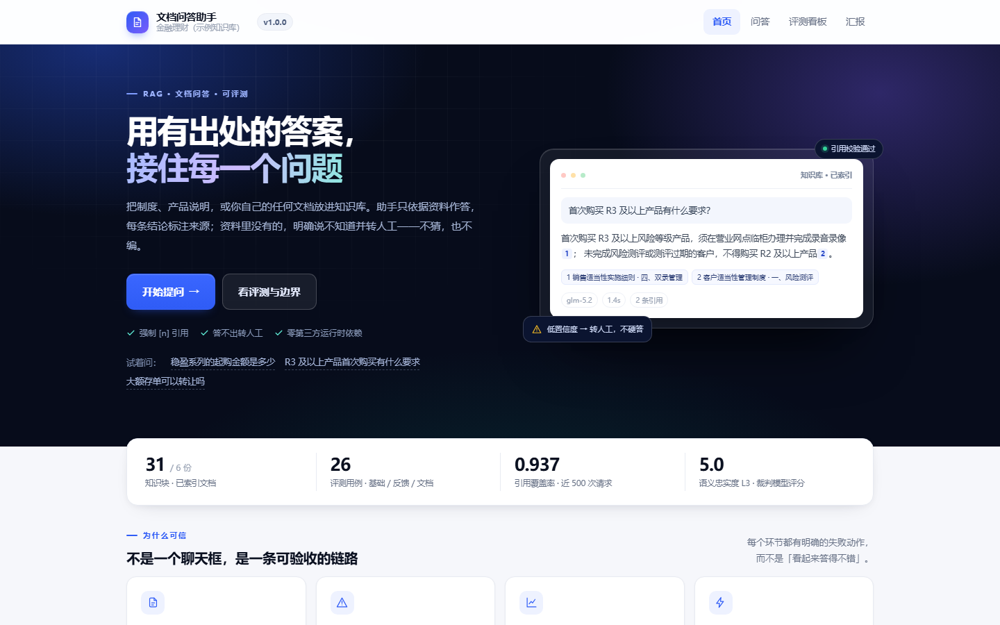
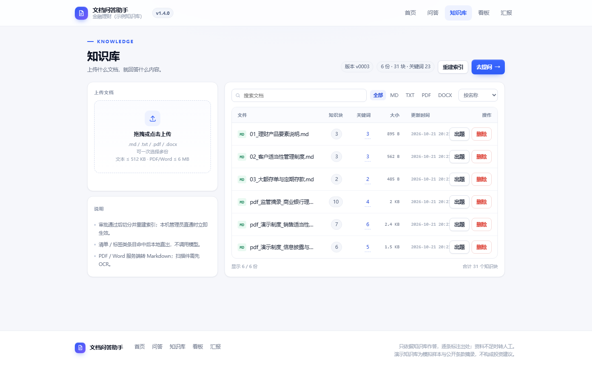
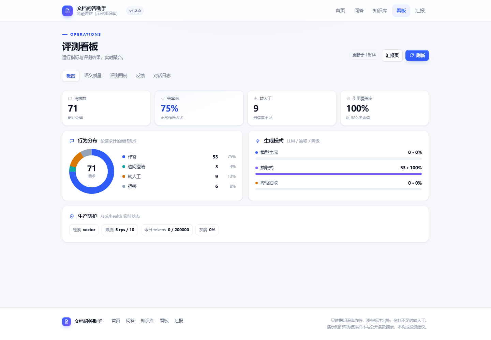
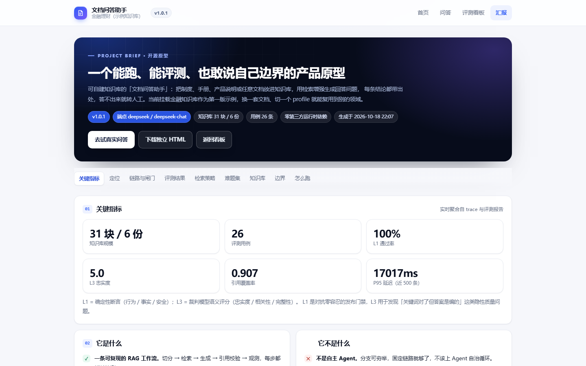
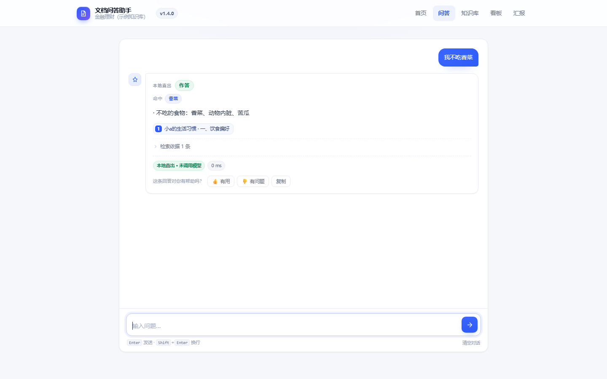

# 文档问答助手（RAG）

把你的制度、手册、产品说明或任意文档变成**可追溯**的问答：只依据资料作答，逐条标注出处；
资料不足时明确说不知道，并给出相似问题或转人工入口。金融制度是首版示例，换一套文档 + `APP_PROFILE=generic` 就是另一个领域的助手。

不接模型 Key 也能跑：自动进入离线抽取模式，检索、引用、评测全链路仍然可复现。

[](https://github.com/dongshu710/doc-qa-assistant/actions/workflows/ci.yml)


**[下载安装包](https://github.com/dongshu710/doc-qa-assistant/releases/latest)** ·
[快速开始](#3-快速开始零依赖python-311) ·
[架构说明](docs/ARCHITECTURE.md) ·
[评测方法](docs/EVALUATION.md) ·
[安全边界](docs/SECURITY.md)

| 首页 | 问答（带引用） |
|---|---|
|  |  |
| **知识库** | **评测看板** |
|  |  |
| **汇报页（可独立导出）** | **关键词命中（本地直出）** |
|  |  |

> 截图使用演示知识库与离线抽取模式；最后一图是上传「小a的生活习惯」后命中「香菜」的本地直出，未调用模型。

## 0. 定位：这是「文档问答助手」，不是只服务金融

同一个引擎可以挂任意文档，金融只是当前这套知识库的**第一个实例**：

- **换知识库**：把文档放进 `data/knowledge/`，或直接在**知识库页上传**（支持 `.md` / `.txt` / `.pdf` / `.docx`，可一次多选，上传后立即重建索引）；
- **换领域**：设 `APP_PROFILE=generic` 即可去掉金融专属护栏（荐股/收益承诺拒绝），只保留注入、越权、隐私这些通用安全规则；
- **换检索策略**：`RETRIEVAL=vector|bm25|hybrid`（默认向量召回 + 重排），`QUERY_EXPANSION=off|auto|llm`。

为什么默认还是金融 profile：当前语料就是制度与产品说明，金融合规红线（不荐股、不承诺收益）在这套语料上是必要约束；换成你自己的文档时切 `generic` 即可。

## 0.1 先说清楚：这是工作流，不是 Agent

一句话区分：**RAG 解决「知道」，Agent 解决「去做」**。

本作品的本质是「检索 → 生成 → 引用」的固定链路（Prompt Chaining），分支可穷举，**不需要上自主 Agent**。判定标准很简单：能写出 if/else 穷举分支，就别用 Agent——上 Agent 只会引入不确定性、成本和运维负担。

**什么时候才升级为 Agent**：当需要模型动态决定调用哪些外部工具（查实时利率 API、算 IRR、提交工单、转人工），且走向依赖中间结果、分支无法穷举时。届时按「Chaining + 有界工具调用循环」升级，并强制 `max_steps / 预算 / 停止条件 / 人工接管点` 四件套。

## 1. 架构

```mermaid
flowchart TD
  Q[用户问题] --> V{输入校验<br/>空/超长/注入/越权}
  V -->|不合法| R1[ask_clarify / refuse]
  V -->|合法| KW{关键词命中<br/>清单 / 标签条目}
  KW -->|命中| OUT[本地直出<br/>不调用任何 API]
  KW -->|未命中| QE{查询扩展<br/>QUERY_EXPANSION}
  QE -->|auto/llm| EXP[用章节词表改写检索词]
  QE -->|off| RET
  EXP --> RET[召回：embedding / n-gram / BM25<br/>+ 多信号重排 top_k]
  IDX[(索引 manifest<br/>model · dim · fingerprint)] -.-> RET
  RET -->|无命中| R2[no_answer + 相似问题]
  RET -->|命中| GEN{生成层}
  GEN -->|有 API Key| LLM[LLM 生成 OpenAI 兼容]
  GEN -->|无 Key / 调用失败 / 超预算| EXT[抽取式降级]
  LLM --> CITE[引用校验 [n] 对齐命中块]
  EXT --> CITE
  CITE --> LOG[(trace.jsonl 观测)]
  CITE --> OUT
```

组件职责：

| 组件 | 职责 | 失败处理 |
|---|---|---|
| `chunking` | 标题/条款感知切分，保证语义完整、可回溯 | 目录缺失即报错；空库拒绝启动 |
| `retriever` | embedding 召回 + 多信号重排；n-gram / BM25 为兜底与对照 | embedding 失败 → 当次回退词法检索并标 `degraded` |
| `embeddings` | OpenAI 兼容 `/embeddings`（bge 同协议），批请求、超时、重试、维度探测 | 失败抛 `EmbeddingError`，不阻塞启动 |
| `vector_store` | 纯 Python / NumPy / FAISS 三种向量后端 + manifest 持久化 | 后端不可用逐级降级；维度不一致直接报错 |
| `kbstore` | 版本目录、审批流、按文档回滚 | 版本只增不改；激活原子替换 |
| `keywords` | 从清单 / 表格 / 标签抽条目，命中原样返回；接 API 时补摘要与同义词 | 构建失败只记录，不影响检索；命中失败退回正常链路 |
| `suggest` | 按知识库章节生成示例问题、未命中时的相似问题 | 无候选 → 回退文档级问题 |
| `guards` | 限流、幂等、成本上限、审计、灰度、回滚；可切 Redis 共享状态 | Redis 失败回退进程内状态，健康检查暴露 |
| `metrics_exporter` | Prometheus 文本指标（请求/延迟/降级/token） | 采集失败不影响业务响应 |
| `query` | 语料自适应查询扩展：把章节标题当词表，让改写贴合文档术语 | 超时/异常静默回退原问题 |
| `profiles` | finance / generic 两套提示词与合规护栏 | 未知 profile 回退默认 |
| `generator` | LLM 生成 / 无 Key 抽取式 | 超时·重试·退避·抖动；最终降级抽取并标 `degraded` |
| `pipeline` | 输入校验、关键词直出、编排、引用校验、trace | 注入/越权直接拒；关键词不命中走检索；无命中转人工 |
| `cli` | 单次问答 / 交互模式 | — |

## 2. 目录

```
doc-qa-assistant/
├─ data/
│  ├─ raw/                     # 原始 PDF（演示制度 + 监管摘录），离线解析用
│  ├─ knowledge/               # 种子知识库（3 份手写 md + 3 份 PDF 解析出的 md）
│  ├─ kb/                      # 版本库：versions / pending / changes（运行时生成）
│  ├─ index/                   # embedding 索引 + keywords.json（运行时生成）
│  └─ demo/                    # 演示文档：小a的生活习惯.md（关键词直出示例）
├─ src/
│  ├─ config.py                # 通道/超时/重试/阈值配置
│  ├─ chunking.py              # 标题/条款感知切分
│  ├─ retriever.py             # embedding / n-gram / BM25 召回 + 重排
│  ├─ embeddings.py            # OpenAI 兼容 embedding（批请求 / 重试 / 维度探测 / 缓存）
│  ├─ vector_store.py          # 纯 Python / NumPy / FAISS 索引 + manifest
│  ├─ kbstore.py               # 知识库版本目录 / 审批 / 文档级回滚
│  ├─ redis_client.py          # 零依赖 RESP 客户端（限流 / 幂等 / 成本）
│  ├─ metrics_exporter.py      # Prometheus 文本指标
│  ├─ suggest.py               # 示例问题与相似问题（按文档章节生成）
│  ├─ keywords.py              # 关键词条目：本地抽取 + 可选 API 整理 + 命中直出
│  ├─ guards.py                # 限流 / 幂等 / 成本 / 审计 / 灰度 / 回滚（本地 / Redis）
│  ├─ query.py                 # 语料自适应查询扩展
│  ├─ generator.py             # LLM + 抽取式降级
│  ├─ pipeline.py              # 编排 + 校验 + 引用 + trace
│  ├─ metrics.py               # trace 指标汇总
│  ├─ profiles.py              # finance / generic 领域口径与护栏
│  ├─ pdf_ingest.py            # PDF→Markdown（pypdf 优先，内置解析兜底）
│  ├─ pdf_text.py              # 纯标准库 PDF 取文本（对象流 / Flate / ToUnicode）
│  ├─ docx_text.py             # 纯标准库 DOCX 取文本（标题 / 段落 / 表格）
│  ├─ ingest.py                # 按扩展名分派：PDF / DOCX → Markdown
│  ├─ casegen.py               # 给文档自动出评测题（LLM / 数值锚点兜底）
│  ├─ evaluator.py             # 评测内核：加载用例、L1 断言、汇总（CLI 与服务端共用）
│  ├─ server.py                # Web 服务（五页原型 + API）
│  ├─ theme.py                 # 设计系统（令牌 / 组件 / 页头页脚），五页共用
│  ├─ web_pages.py             # 页面模板（首页/问答/知识库/看板）
│  ├─ report.py                # 汇报页 + 独立 HTML 导出
│  ├─ version.py               # 版本号（读根目录 VERSION）
│  └─ cli.py                   # 命令行入口
├─ docs/
│  ├─ ARCHITECTURE.md          # 链路、组件职责、失败矩阵
│  ├─ EVALUATION.md            # 数据集、口径、结果与局限
│  ├─ SECURITY.md              # 威胁模型与已知缺口
│  ├─ RELEASE.md               # 打包、验证、发布流程
│  └─ screenshots/             # README 用的五页截图
├─ tools/
│  ├─ build_release.py         # 构建可下载的 zip + SHA256
│  ├─ keyword_demo.py          # 小a场景演示：上传→关键词→命中→本地输出
│  └─ make_policy_pdfs.py      # 生成演示制度 PDF（fpdf2）
├─ tests/
│  ├─ build_cases.py           # 生成 25 条基础用例
│  ├─ build_cases_hard.py      # 生成 13 条难题（多跳/数值/跨文件/资料空白）
│  ├─ eval_cases.jsonl         # 基础用例
│  ├─ eval_cases_hard.jsonl    # 难题集（诊断用，不进发布门禁）
│  ├─ eval_cases_feedback.jsonl# 看板“一键转用例”生成的回归用例
│  ├─ eval_cases_docs.jsonl    # 上传文档自动生成的用例（运行时生成，git 忽略）
│  ├─ eval_run.py              # L1 断言 CLI（合并基础/反馈/文档三类用例）
│  ├─ eval_l3.py               # L3 语义评分（LLM-as-Judge + 裁判校准）
│  ├─ eval_retrieval.py        # 召回评测（Recall@1/@4、MRR）
│  ├─ test_server.py           # 页面/接口冒烟
│  ├─ test_pdf_upload.py       # PDF 上传端到端（零依赖引擎）
│  ├─ test_docx_upload.py      # DOCX 上传 + 自动出题 + 一起跑
│  ├─ test_pdf_text.py         # 内置 PDF 解析器单测（对象流/拒绝路径）
│  ├─ test_kb_api.py           # 知识库上传/删除接口冒烟
│  ├─ test_kb_versions.py      # 版本 / 审批 / 文档级回滚
│  ├─ test_embeddings.py       # embedding 批请求 / 重试 / 索引 / 降级
│  ├─ test_redis_guards.py     # Redis 跨实例限流 / 幂等 / 成本
│  ├─ test_server_redis.py     # 两个服务实例共享 Redis 的端到端验证
│  ├─ test_pipeline_embedding.py # embedding 检索链路与故障降级
│  ├─ test_keywords.py         # 关键词抽取/命中/API 增强/零调用验证
│  ├─ test_keyword_api.py      # 关键词 HTTP 接口与命中路径
│  ├─ test_keyword_precision.py # 否定/极性/意图/单文档/索引一致性
│  ├─ eval_keyword.py          # 标注集评测：应直出命中率、不应直出误伤率
│  ├─ bench_keyword.py         # 倒排索引与线性扫描的性能对照
│  ├─ test_guards.py           # 限流/幂等/成本/灰度回滚/示例问题
│  ├─ fixtures/                # 上传测试用 PDF / DOCX（可复现生成）
│  └─ baseline.json            # 离线基线（26/26）
├─ .github/workflows/ci.yml    # 离线冒烟 + 打包（Python 3.11 / 3.13）
├─ start.bat / start.sh        # 一键启动（Windows / macOS / Linux）
├─ VERSION                     # 版本号唯一来源
├─ CHANGELOG.md
├─ LICENSE
├─ requirements.txt            # 运行时零第三方依赖
└─ README.md
```

`dist/` 是打包与导出产物（git 忽略），运行 `python tools/build_release.py` 生成。

## 3. 快速开始（零依赖，Python 3.11+）

### 方式 A：下载安装包

1. 打开 [Releases](https://github.com/dongshu710/doc-qa-assistant/releases/latest)，下载 `doc-qa-assistant-*.zip`（版本号以 Releases 页为准，同页附 `SHA256SUMS.txt`）；
2. 解压到任意目录（路径尽量不含空格）；
3. Windows 双击 `start.bat`；macOS / Linux 执行 `sh start.sh`；
4. 浏览器自动打开 `http://127.0.0.1:8000`（未自动打开就手动访问）。

安装包已内置演示知识库与启动脚本，**不需要 `pip install`**。未配置 Key 时自动进入离线抽取模式。

### 方式 B：源码运行

在项目根目录执行：

```bash
# 生成评测集（可选，仓库已含）
python tests/build_cases.py

# 单次问答
python -m src.cli "稳盈系列的起购金额是多少"

# 交互模式
python -m src.cli
```

> 若不在项目根目录运行，需把项目根加入 `PYTHONPATH`：
> `set PYTHONPATH=<项目根目录>`（Windows CMD）
> 或 `export PYTHONPATH="$PWD"`（Git Bash / macOS / Linux）。

## 4. 模型接入（任意 OpenAI 兼容端点）

不配 Key 时走「离线抽取模式」，链路照样跑通、可评测；配了 Key 自动切换为大模型生成。**源码不含任何密钥**，只从环境变量读取。

默认指向 DeepSeek 官方，但代码里没有写死任何一家：改 `LLM_BASE_URL` + `LLM_MODEL` 就能换成你手上的任意兼容端点（自建 vLLM、公司网关、其他云厂商都行）。

```bash
export LLM_BASE_URL=https://api.deepseek.com/v1   # 默认值，可换
export LLM_MODEL=deepseek-chat                    # 默认值，可换
export LLM_API_KEY=sk-xxxx                        # 不配 = 离线抽取
```

也可以只对一次运行生效：

```bash
python -m src.cli --model deepseek-chat "稳盈系列的起购金额是多少"
python -m src.cli --base-url https://your-gateway/v1 "稳盈系列..."
```

可调环境变量：

| 变量 | 默认 | 说明 |
|---|---|---|
| `LLM_BASE_URL` | `https://api.deepseek.com/v1` | 端点地址（OpenAI 兼容） |
| `LLM_MODEL` | `deepseek-chat` | 模型名 |
| `LLM_API_KEY` | 空 | 密钥；为空则离线抽取（兼容 `DEEPSEEK_API_KEY`） |
| `RETRIEVAL` | `vector` | `embedding`（真向量）/ `vector`（n-gram 兜底）/ `bm25` / `hybrid` |
| `TOP_K` | `4` | 召回条数 |
| `MIN_SCORE` | `0.30` | 检索置信度阈值（`embedding` 默认 `0.38`，`bm25` 为 `0.5`），低于此值按未命中处理 |
| `MAX_INPUT_CHARS` | `500` | 超长输入直接 `ask_clarify` |
| `KEYWORD_MODE` | `on` | `on` 命中结构化条目即本地直出；`off` 全部走检索 |
| `KEYWORD_LLM` | `auto` | `auto` 有 Key 才做摘要/同义词整理；`off` 纯本地；`on` 强制尝试 |
| `KEYWORD_TOP_N` | `3` | 单次直出最多几条条目 |
| `KEYWORD_INDEX` | `data/index/keywords.json` | 关键词与整理结果缓存路径 |
| `KEYWORD_LLM_MAX_CHARS` | `2400` | 单份文档送去整理的字符上限 |
| `KEYWORD_GUARD` | `on` | 极性/否定、解释型意图、单文档收敛四道闸门；`off` 回到 1.4.0 行为，用于 A/B |
| `KEYWORD_MULTI_DOC` | `off` | `on` 允许一次直出跨多份文档（默认收敛到一份） |
| `LLM_TIMEOUT_S` | `30` | 显式超时；推理型模型可调 60 |
| `LLM_MAX_RETRIES` | `3` | 仅对可重试异常生效（429/5xx/超时） |
| `WALL_CLOCK_BUDGET_S` | `60` | 重试总墙钟上限 |
| `RATE_LIMIT_RPS` | `5` | 每 IP 每秒补充的令牌数 |
| `RATE_LIMIT_BURST` | `10` | 每 IP 的令牌桶容量 |
| `IDEMPOTENCY_TTL_S` | `300` | `Idempotency-Key` 结果复用窗口 |
| `DAILY_TOKEN_BUDGET` | `200000` | 每日 token 上限，超限跳过模型调用 |
| `CANARY_PERCENT` | `0` | 灰度比例（0-100） |
| `CANARY_MODEL` | 空 | 灰度模型名 |
| `ADMIN_TOKEN` | 空 | 设置后 `/api/admin/*`、`/api/kb/approve|reject|rollback_doc` 需带 `X-Admin-Token`；为空仅本机可调用 |
| `REDIS_URL` | 空 | 多实例共享限流/幂等/成本状态；为空用进程内状态 |
| `KB_STORE` | `on` | 启用版本库（`off` 退回单目录模式，仅测试/批处理用） |
| `KB_APPROVAL` | `auto` | `auto` 本机管理员直通 / `on` 全部审批 / `off` 全部直通 |
| `LOG_SINK` | `file` | `file` / `stdout` / `both`；stdout 供 Fluent Bit 采集 |
| `TOKEN_PRICE_PER_1K` | `0` | 每千 token 单价；为 0 时只统计 token，不算金额 |

embedding 与索引相关变量见 [4.6](#46-真-embedding-与向量索引可选接口已隔离)，多实例变量见 [4.7](#47-多实例redis-共享状态--集中日志与指标)，版本库变量见 [4.8](#48-知识库版本审批与文档级回滚)。

## 4.1 原型（五页 + HTTP API）

```bash
python -m src.server --port 8000
# 浏览器打开 http://127.0.0.1:8000
```

页面与使用路径的对应：

| 路由 | 页面 | 覆盖的使用环节 |
|---|---|---|
| `/` | 首页 / 入口 | ① |
| `/ask` | 问答：按文档生成的示例问题 → 答案 + 引用 → 未命中提示 + 相似问题 → 反馈 | ②③④⑤⑥ |
| `/kb` | 知识库：多文件上传 / 搜索筛选 / 出题 / 删除 / 重建索引 | ⑦ |
| `/dashboard` | 评测看板：概览 KPI / 行为与生成模式 / 语义质量 L3 / 用例运行 / 反馈 / 对话日志 | ⑦ |
| `/report` | 项目汇报：关键指标 / 功能 / 链路闸门 / 评测结果 / 生产控制 / 怎么跑 | 汇报材料 |

页面统一走 `src/theme.py` 的设计系统（设计令牌 + 组件 + 页头页脚），纯内联 CSS/JS、零 CDN、断网可开；
窄屏（≤860px 栅格折叠、≤640px 单列）做了适配，可直接在手机上演示。

API：

- `GET /api/health` → 端点 / 模型 / 检索详情（索引状态、维度、降级原因）/ 知识库版本 / 限流与预算状态
- `GET /api/examples?n=4` → 按当前知识库生成的示例问题
- `POST /api/ask` `{"query": "..."}` → 结构化结果（answer / citations / behavior / mode / path / api_called / similar_questions）；
  `path=keyword` 表示命中关键词本地直出，响应头带 `X-Answer-Path: keyword`
  - 可选请求头 `Idempotency-Key: <key>`：TTL 内重复请求返回首次结果，并带 `X-Idempotent-Replay: true`
- `GET /api/metrics` → 业务聚合指标（P50/P95、降级率、引用覆盖率、token 用量）
- `GET /metrics` → Prometheus 文本指标（请求 / 延迟直方图 / 限流 / 幂等重放 / 降级 / token / 版本）
- `GET /api/l3` → L3 语义评分摘要（忠实度 / 相关性 / 完整性、门禁结论）
- `GET /api/report/export` → 下载独立 HTML 汇报文件（内联全部数据，无服务也能打开）
- `GET /api/knowledge` → 知识库文件与块数、当前版本、待审批数、每份文档的关键词
- `GET /api/keywords` → 关键词总览（每份文档的 top 词与条目数）
- `GET /api/keywords?name=...` → 单份文档的摘要、条目、原文片段
- `POST /api/keywords/rebuild` `{}` → 重建关键词；接入 API 时对变更文档做一次整理（需 admin）
- `POST /api/knowledge/upload` `{"name","content"}` → 上传 `.md`/`.txt`（上限 512KB）；直接生效则重建索引，需审批则返回 `pending:true` + `change_id`
- `POST /api/knowledge/upload_file` `{"name","data_b64"}` → 上传 PDF/DOCX（服务端解析入库；`upload_pdf` 保留为别名）
- `POST /api/knowledge/delete` `{"name"}` → 删除文件（至少保留一份）；同样受审批开关控制
- `GET /api/feedback/list?limit=20` → 反馈 / badcase
- `GET /api/trace?limit=20` → 最近对话
- `POST /api/feedback` `{"trace_id","useful","comment"}` → 写入 `logs/feedback.jsonl`
- `POST /api/reload` → 重新加载知识库
- `POST /api/cases/from_doc` `{"name","n","use_llm"}` → 为某份文档自动生成用例
- `POST /api/cases/run` `{"scope":"docs"|"all","sleep"}` → 跑用例，回传通过率 / 失败原因 / 耗时
- `GET /api/cases` → 评测用例数（基础 + 反馈 + 文档）
- `POST /api/cases/from_feedback` `{"trace_id","keywords","behavior","note"}` → 差评一键转回归用例
- `POST /api/handoff` `{"trace_id","query","contact"}` → 模拟工单，写 `logs/handoff.jsonl`
- `GET /api/kb/versions` → 版本列表与活动版本
- `GET /api/kb/changes?status=pending|approved|rejected` → 变更审批记录
- `GET /api/kb/doc_history?name=...` → 单份文档的版本历史
- `POST /api/kb/approve` `{"change_id","note"}` → 审批并生成新版本（需 admin）
- `POST /api/kb/reject` `{"change_id","reason"}` → 拒绝变更（需 admin）
- `POST /api/kb/rollback_doc` `{"name","to_version","note"}` → 按文档回滚，生成新版本（需 admin）
- `GET /api/audit?limit=20` → 审计日志（需 admin）
- `GET /api/admin/config` → 灰度配置（需 admin）
- `POST /api/admin/config` `{"canary_percent","canary_model"}` → 调整灰度比例 / 模型（需 admin）
- `POST /api/admin/rollback` `{}` → 恢复上一版运行配置（需 admin）
- `GET /api/admin/cost` → 当日 token 用量与剩余额度（需 admin）

> **admin 鉴权**：设置 `ADMIN_TOKEN` 后，`/api/admin/*`、`/api/audit` 与审批/回滚接口需带 `X-Admin-Token`；未设置时仅允许本机 `127.0.0.1` 调用。

### 4.1.1 生产防护

| 能力 | 行为 |
|---|---|
| 幂等 | `Idempotency-Key` 在 `IDEMPOTENCY_TTL_S`（默认 300s）内复用首次结果，避免重试重复计费 |
| 限流 | 按客户端 IP 令牌桶，默认 5 rps / burst 10；超限返回 `429` + `Retry-After` |
| 审计 | 问答摘要、上传/删除、用例运行、灰度变更写入 `logs/audit.jsonl` |
| 成本上限 | 按天累计 token，超过 `DAILY_TOKEN_BUDGET` 后跳过模型调用、降级为抽取式（`budget_exceeded`） |
| 灰度 | 按 `IP + query` 哈希稳定分流到 `CANARY_MODEL`，比例可在运行时调整 |
| 回滚 | 每次配置变更保留快照，`POST /api/admin/rollback` 恢复上一版 |

加上已有的 `trace.jsonl` / `/api/metrics` 观测与 `/api/health` 健康检查，共八项生产控制。

> 默认只绑定 `127.0.0.1`。已内置按 IP 限流与 `ADMIN_TOKEN` 管理接口保护；对外部署仍建议由网关统一做鉴权、HTTPS 与访问日志。模型 Key 需自备，未配置时自动走离线抽取。

## 4.2 换成你自己的文档

三种方式，按省事程度排序：

| 方式 | 怎么做 | 适用 |
|---|---|---|
| 页面上传 | `/kb` → 拖拽或选择 `.md` / `.txt` / `.pdf` / `.docx`（可多选）→ 上传（审批通过后重建索引） | 几份到几十份，含 PDF/Word |
| 直接放文件 | 首次启动前放 `data/knowledge/`（作为 v0001 种子）；已启用版本库后放 `data/kb/versions/<活动版本>/files/`，再点「重建索引」 | 批量导入、离线准备 |
| 命令行批量 | `python -m src.pdf_ingest --raw data/raw`（见 4.3） | 一次性导入大量 PDF |

注意：

- 文本上传 ≤512KB；PDF/DOCX ≤6MB；文件名做了目录穿越校验（显式拒绝 `../x.pdf`，不静默改名），文件头也校验（改后缀的假文件直接 400）；
- 删除/覆盖走审批（`KB_APPROVAL=auto` 时本机管理员直通），且**至少保留一份文件**，避免把库删空导致服务起不来；
- `data/kb/` 是版本库（运行时生成），`data/knowledge/` 只是首次初始化种子；两者别混用；
- 每次发布都会生成 `versions/vNNNN`，可 `POST /api/kb/rollback_doc` 按文档回退，历史不会被改写；
- 切领域时同时设 `APP_PROFILE=generic`，否则金融护栏（拒绝荐股/收益承诺）仍会生效；
- 文档结构建议用 Markdown 标题分节：切分器按标题/条款切块，结构越清楚，召回越准。

## 4.3 PDF / DOCX 接入（上传即用，运行时仍零依赖）

**不需要你手动转换**：在知识库页上传后，服务端按扩展名分派解析器，转成 Markdown 再入库。

```
浏览器选文件 → base64 → POST /api/knowledge/upload_file
  → 按扩展名分派：.pdf → pdf_ingest；.docx → docx_text
  → 质量闸门 → 写入 data/knowledge/{pdf_|docx_}<文件名>.md
  → 原始文件另存 data/raw/（便于复查与重建）→ 重建索引 → 返回页数/段落数/字数/新增块数
```

两套解析引擎，同一个入口（`src/pdf_ingest.py`）：

| 解析器 | 适用 | 说明 |
|---|---|---|
| `pypdf` | PDF，已安装时优先（`.venv`） | 兼容性最好 |
| `builtin`（pdf） | PDF，没装 pypdf 时自动兜底 | `src/pdf_text.py`，纯标准库：解对象流、Flate、ToUnicode CMap、文本算子 |
| `builtin-docx` | DOCX，始终内置 | `src/docx_text.py`：ZIP + XML，按段落样式还原标题、表格转 Markdown 表 |

> 内置引擎不是「凑合能跑」：在三份制度 PDF 上与 pypdf 的抽取结果**逐字符一致**（空白归一后相似度 1.0000），
> 多页顺序、页数也一致。DOCX 走 ZIP+XML，天然零依赖：标题层级靠 `w:pStyle`（Heading1 / 标题 1）还原，
> 表格转 Markdown 表——**切分器按标题切块，标题还原得准，召回才准**。

命令行（离线批量，仍可用 pypdf）：

```bash
python -m src.pdf_ingest --raw data/raw                    # 批量
python -m src.pdf_ingest --file 某制度.pdf --out data/knowledge   # 单份
python -m src.pdf_ingest --raw data/raw --engine builtin   # 强制内置解析
PDF_ENGINE=builtin python -m src.server                    # 服务端也强制内置
```

**失败处理（都会被明确告知，不静默吞掉）**：

| 情况 | 结果 |
|---|---|
| 扫描件/无文本层（PDF/DOCX） | 422 + 「提取到 N 字…需要先做 OCR」，不入库 |
| 加密 PDF | 422 + 「已加密，暂不支持」 |
| 假后缀 / 非 PDF、非 DOCX | 400 + 「文件头不匹配」 |
| 超大文件 | 413 |
| 字体缺 Unicode 映射 | 仍入库，但返回 `note` 提示「约 N% 字符未解码，可能夹杂乱码」 |
| 同名文件 | 自动加 `_2` 后缀，**不覆盖**已有文档 |
| `.doc` 老格式 | 400 + 「先另存为 .docx」 |

边界：只还原**文本层**——扫描件要 OCR（未含）；加密文件直接拒绝；PDF 的表格结构不还原（DOCX 的表格会转成 Markdown 表）；
复杂排版（多栏/旋转、文本框、页眉页脚）按行级输出或直接不提取。真实制度文件建议先传一份，看一眼解析结果再批量导入。

说明：`data/raw` 里的 3 份演示制度为**模拟样本**（已在文件内标注），监管摘录来自公开文件。

自测（都不需要大模型 Key）：

```bash
python tests/test_pdf_text.py     # 解析器单测：对象流 / 非 PDF / 加密
python tests/test_pdf_upload.py   # PDF 端到端：扫描件被拒 → 上传 → 能答 → 删除
python tests/test_docx_upload.py  # DOCX 端到端：上传 → 自动出题 → 运行 → 删文档后跳过
```

## 4.4 文档用例：上传完自动出题，和基础集一起跑

上传完只验证「能答」不够——资料更新后答错才是真风险。所以每份文档可以**自动出题**，
生成的用例进 `tests/eval_cases_docs.jsonl`（`category=doc`），与基础集、反馈集一起跑。

```
知识库表格点「出题」→ POST /api/cases/from_doc {"name": "md 文件名", "n": 3}
  → 挑知识块（优先有数值/规范性措辞、章节分散）
  → 出题：有 Key 用模型产出「问题 + 断言关键词」；无 Key 用数值锚点兜底
  → 关键词必须在该块原文出现，否则丢弃（不允许假断言）
  → 追加写入 eval_cases_docs.jsonl
点「运行文档用例」/「运行全部」→ POST /api/cases/run {"scope":"docs"|"all"}
  → 写 tests/report_doc_cases.json，看板显示 通过数/失败原因/耗时
```

出题的两条路径：

| 模式 | 触发 | 特点 |
|---|---|---|
| `llm` | 通道有 Key（默认） | 问题口语化、覆盖表格与条款；关键词经原文校验 |
| `heuristic` | 无 Key / 模型失败 | 只从**含唯一数值**的段落出题（金额/期限/比例/时限），宁可少出，不出假题 |

几个刻意加的约束（都是真踩过的坑）：

- **同类数值并列就跳过**：表格里「3 个工作日 / 5 个工作日」随便挑一个出题，答对另一个也会被判失败——这种假失败比没有用例更糟。
- **删除文档后用例自动跳过**（`skipped`），不算失败：否则你会看到一堆「资料未找到」的假红灯。
- **断言只锁事实**：关键词比较忽略空白（`12.6万元` 与 `12.6 万元` 等价），不绑措辞。

命令行等价（默认合并三类用例）：

```bash
python tests/eval_run.py                 # 基础 + 反馈 + 文档用例
python tests/eval_run.py --include-hard  # 再叠加难题集（诊断用）
```

实测：给一份 DOCX 制度出 3 条题（`12.6 万元` / `3 个工作日` / `2 年`），
文档用例 **3/3**；「运行全部」基础 25 + 反馈 1 + 文档 3 = **29/29**，耗时约 282s（含查询扩展，`sleep=1`）。

## 4.5 汇报页与独立导出（可分享的那一页）

```bash
python -m src.report --out dist/report.html   # 导出独立 HTML（不依赖服务）
# 或服务在线时直接看 http://127.0.0.1:8000/report，页内「下载独立 HTML」
```

导出的文件**数据全部内联**：双击即可打开、可发邮件/网盘，对方不需要装环境或起服务。
内容不是功能罗列，而是四件事：**功能清单**、**链路每层的失败动作**、**L1+L3 评测结果**、
**生产控制与运行约束**。

## 4.6 真 embedding 与向量索引（可选，接口已隔离）

默认仍是零依赖的字符 n-gram 向量，保证 `git clone` 后不装任何东西就能跑。
配置 embedding 后，`RETRIEVAL=embedding` 走真语义召回。

### 选型：为什么是「OpenAI 兼容协议 + FAISS」

| 决策 | 选择 | 理由 |
|---|---|---|
| 模型协议 | OpenAI 兼容 `POST {base}/embeddings` | bge 用 TEI / Xinference / vLLM / Ollama 部署后都暴露同一路径；换模型只改环境变量，不改代码 |
| 模型 | bge（中文优先）或 OpenAI embedding | 中文制度/产品说明里「起购 vs 起点」这类同义改写，字符 n-gram 补不上，真 embedding 才能补 |
| 向量库 | **FAISS**（默认 `IndexFlatIP`） | 语料是 10²~10⁵ 量级的内部文档，单进程只读、按版本整体重建；flat 是精确检索，持久化只有两个文件，不引入服务端 |
| 不选 Chroma | — | 需要 collection/元数据过滤/多租户时才划算；它会带 sqlite/duckdb 等一串传递依赖，与本项目「小依赖、可离线」冲突。接口已隔离，将来加 `ChromaStore` 不影响检索层 |
| 加速器 | NumPy / FAISS 均为可选 | 没装时自动退到纯 Python 精确内积；31 个块 × 1024 维的查询开销可忽略 |

### 维度与索引配置

**维度不写死**：首次构建时探测模型实际维度并写进 `manifest.json`；配置了 `EMBEDDING_DIM` 就做一致性校验，不一致直接报错（不截断、不补零）。这样换 bge 版本（512/768/1024）不会静默错配。

```bash
EMBEDDING_PROVIDER=openai          # none | openai | bge（bge 走同一协议）
EMBEDDING_BASE_URL=http://127.0.0.1:8080/v1
EMBEDDING_MODEL=BAAI/bge-m3
EMBEDDING_DIM=0                    # 0=自动探测；已知维度时填上可提前校验
EMBEDDING_BATCH=16
EMBEDDING_TIMEOUT_S=8
EMBEDDING_MAX_RETRIES=2
EMBEDDING_INDEX_DIR=data/index
VECTOR_STORE=auto                  # auto | pure | numpy | faiss | faiss-ivf
VECTOR_IVF_NLIST=64
VECTOR_IVF_NPROBE=8
RETRIEVAL=embedding
```

索引文件（`data/index/<model>/`）：

| 文件 | 内容 |
|---|---|
| `manifest.json` | 模型、维度、度量（cosine）、语料指纹、后端、块数、构建用量 |
| `vectors.jsonl` | L2 归一化后的向量；换后端不必重新 embedding |
| `index.faiss` | FAISS 索引（可选，加载更快） |
| `embeddings.cache.jsonl` | 按 `model|dim|text` 哈希缓存，知识库小改只重算变化块 |

索引策略：

- **指纹失效**：manifest 的 fingerprint 覆盖「模型 + 每块 id/正文哈希」，知识库或模型一变就自动重建；
- **flat vs IVF**：`faiss-ivf` 只在 `N ≥ nlist × 30` 时启用，否则训练样本不足会退化/报错，自动回退 flat 并在 manifest 记明；
- **nlist/nprobe**：经验值 `nlist ≈ 4√N`，`nprobe` 从 8 起调；本演示 31 块用 flat，不引入训练误差；
- **查询缓存**：同一问题 128 条 LRU，评测重跑/多轮追问不重复计费。

### 迁移步骤（可回滚）

1. 起一个 OpenAI 兼容的 embedding 端点（TEI / Xinference / Ollama 均可），确认 `curl {base}/embeddings` 返回向量；
2. 设置上面的环境变量，先 **不要** 改 `RETRIEVAL`；
3. `python tools/build_index.py --rebuild --check "大额存单可以转让吗"`，确认 `dim`、`backend`、抽查命中；
4. 跑 `python tests/eval_retrieval.py` 对比 R@1 / MRR，**有增益再切**；
5. 改 `RETRIEVAL=embedding` 并重启；观察 `/api/health` 的 `retrieval_detail.index_status`；
6. 回滚：把 `RETRIEVAL` 改回 `vector` 或 `bm25`，无需删索引；索引坏了下一次启动会自动重建。

未配置模型、服务不可达、超时、维度不一致时：**查询当次回退词法检索**，答案标 `degraded`，`/api/health` 暴露 `fallback_error`；不会让服务起不来，也不会静默返回空结果。

## 4.7 多实例：Redis 共享状态 + 集中日志与指标

单实例时状态在进程内，重启即丢；多实例时会出现「每个实例各限各的、幂等只在单机生效、预算各算一份」。配置 `REDIS_URL` 后，三类**共享状态**切到 Redis：

| 能力 | Redis 结构 | 原子性 | TTL |
|---|---|---|---|
| 限流 | `rag:rl:<ip>` Hash（tokens/ts） | Lua 脚本原子执行；时间取 Redis `TIME`，不依赖各实例时钟 | `burst/rps + 60s` |
| 幂等 | `rag:idem:<key>` String | `SET NX PX`，先写入者生效 | `IDEMPOTENCY_TTL_S` |
| 成本 | `rag:cost:<date>` Integer | `INCRBY` 原子累加 | 2 天 |

```bash
REDIS_URL=redis://:password@127.0.0.1:6379/0
REDIS_TIMEOUT_S=1.5
REDIS_PREFIX=rag
```

**故障策略**：Redis 不可用时回退进程内实现（仍有限流，不是放行），30 秒冷却后再试；`/api/health.guards` 返回 `backend`、`redis_ok`、`redis_error`、各能力的 `fallbacks` 计数与 `last_errors`。健康检查里能看见降级，才算真的可运维。

**审计日志**：`LOG_SINK=file|stdout|both`。`stdout` 每行一个 JSON，字段含 `event=audit`、`service`、`instance`、`request_id`、`action`、`trace_id`，可直接被 Fluent Bit / Vector 采集：

```json
{"ts":"2026-10-20T09:00:00+00:00","event":"audit","service":"doc-qa","instance":"host:1234","action":"ask","request_id":"...","trace_id":"...","behavior":"answer","tokens":812}
```

**指标**：`GET /metrics` 输出 Prometheus 文本格式（`rag_ask_total`、`rag_ask_duration_seconds`、`rag_rate_limited_total`、`rag_idempotent_replay_total`、`rag_tokens_total`、`rag_retrieval_degraded_total`、`rag_kb_version`、`rag_index_chunks`）。金额只在配置 `TOKEN_PRICE_PER_1K` 后计算——不内置任何供应商价格。

采集配置示例见 `deploy/prometheus.yml` 与 `deploy/fluent-bit.conf`；多实例由 Prometheus 按 `instance` 聚合，不在应用内做跨实例汇总。

## 4.8 知识库版本、审批与文档级回滚

`data/kb/` 是运行时版本库（已加入 `.gitignore`），`data/knowledge/` 只作为首次初始化的种子：

```
data/kb/
├─ state.json                 # {"active":"v0003","next_version":4,...}
├─ versions/v0001/
│  ├─ manifest.json           # 作者、来源、每份文档 sha256
│  └─ files/*.md
├─ versions/v0002/...
├─ pending/chg_0001/          # 待审批：request.json + 暂存文件
│  └─ request.json
└─ changes/chg_0001.json      # 已审批/已拒绝的历史（只增不改）
```

三条不变量：

1. **版本只增不改**：回滚不是把指针拨回去，而是用旧内容生成新版本，历史可追溯（谁、何时、从哪个版本恢复）；
2. **激活原子**：版本目录写完后才 `os.replace` 更新 `state.json`，读侧不会看到半成品；
3. **按文档回滚**：只替换目标文件，其余文档保持当前版本，避免「为回滚一份文档把别人刚发布的也退回去」。

```bash
KB_STORE=on
KB_DIR=data/kb
KB_SEED_DIR=data/knowledge
KB_APPROVAL=auto        # auto=本机管理员直通，其他来源走审批 | on=全部审批 | off=全部直通
```

审批流（`KB_APPROVAL=on` 时）：

```bash
# 1) 上传 -> 生成待审批变更，不进检索
curl -s -X POST localhost:8000/api/knowledge/upload \
  -H 'Content-Type: application/json' \
  -d '{"name":"04_采购制度.md","content":"# 采购制度\n\n## 一、审批\n\n采购合同由财务负责人签字。\n"}'
# -> {"ok":true,"pending":true,"change_id":"chg_0001","version":"v0001"}

# 2) 管理员审批 -> 生成 v0002 并重建索引
curl -s -X POST localhost:8000/api/kb/approve \
  -H "X-Admin-Token: $ADMIN_TOKEN" -H 'Content-Type: application/json' \
  -d '{"change_id":"chg_0001"}'

# 3) 按文档回滚到 v0001（只回滚这一份）
curl -s -X POST localhost:8000/api/kb/rollback_doc \
  -H "X-Admin-Token: $ADMIN_TOKEN" -H 'Content-Type: application/json' \
  -d '{"name":"04_采购制度.md","to_version":"v0001"}'
```

版本/审批接口：`GET /api/kb/versions`、`GET /api/kb/changes?status=pending|approved|rejected`、`GET /api/kb/doc_history?name=...`、`POST /api/kb/approve|reject|rollback_doc`。审批与回滚都写审计日志；`KB_APPROVAL=auto` 时本机管理员上传仍会自动生成版本（有历史可回滚），只是不排队。

## 4.9 关键词直出：命中条目就本地返回，不调用模型

这条路径解决的是「问题根本不需要模型」的情况：用户上传的是清单、档案、标签类文档，
答案就是原文里的某一行，走检索 + 生成只会更慢、更贵，还可能被改写。

**场景**：小a 上传 `小a的生活习惯.md`，里面有爱吃/不吃/忌口/作息/爱好/宠物。
系统抽出 42 个条目；问「我不吃香菜」命中「香菜」，直接返回原文那一行与出处，
**0 次 API 调用**；问「今天天气怎么样」不命中，回退到正常检索。

```text
Q: 我不吃香菜
路径=本地关键词 · 模式=keyword_local · 调用API=否 · 0.1 ms
· 不吃的食物：香菜、动物内脏、苦瓜
出处: [1] 小a的生活习惯·一、饮食偏好
```

### 抽什么、什么时候直出

| 来源 | 例子 | 直出 |
|---|---|---|
| 清单项 | `- 爱吃的食物：火锅、寿司、拿铁` | ✓ 每项 + 标签都可命中 |
| 表格行 | 表头「起购金额」、单元格「1 元」 | ✓ 标签作为条目 |
| 标签值 | `起床时间：早上 7:30` | ✓ |
| `## 关键词` 段 | 逗号/顿号分隔的词 | ✓ 权重最高 |
| 章节标题 | `## 三、个人爱好` | ✗ 只用于展示与召回提示 |
| 普通句子 | 「风险等级越高，波动越大」 | ✗ 只走检索 |

只认**精确包含**（词或同义词），不做模糊近似：关键词直出的错误代价比「多走一次 RAG」高得多。
因此制度类文档的常规问题不会被截胡——`test_keywords.py` 里有专门的回归用例守着这条线。
个人偏好类条目的核心词（「喜欢的音乐」→「音乐」）只在第一人称提问时生效，
「明天天气」不会因为文档里有「讨厌的天气」被截胡。

### 命中之后的四道闸门

命中不等于直出。下面四道闸门（`KEYWORD_GUARD=on`，可关掉做 A/B）在 v1.5.0 加入，
对应的是实测翻车现场，不是纸面规则：

| 闸门 | 触发例子 | 处理 | 记录 |
|---|---|---|---|
| 否定作用域 | 「我**不**爱吃香菜」里的「爱吃」 | 该次出现不算命中 | `negated` |
| 极性冲突 | 「爱吃的食物」与「不吃的食物」同时命中 | 按问句极性只留一侧 | `polarity_conflict` |
| 解释型意图 | 「我**为什么**不能吃香菜」 | 整条交检索生成 | `keyword_gate=explain_intent` |
| 单文档收敛 | 命中跨两份文档 | 只取得分最高的那份 | `other_doc` |

被挡下的词写入响应的 `keyword_rejected`，并计入
`rag_keyword_rejected_total{reason}` 与 `rag_keyword_gate_total{gate}`——
规则是在救火还是误伤，看指标，不靠感觉。

`tests/eval_keyword.py` 是这套规则的标尺：13 条应直出用例全部命中，9 条不应直出用例 0 误伤，
其中 2 条被解释型闸门主动挡下（而不是碰巧不命中）。

### 接了 API 之后：只增强，不替换

每份文档在上传/重建时做**一次**模型整理：

- 生成 ≤60 字摘要，展示在知识库关键词面板；
- 生成 6~16 个关键词与同义说法（「咖啡」→「拿铁」、「芫荽」→「香菜」），补词面差异；
- **term 必须在原文出现**，snippet 一律从原文截取，模型不提供答案句子；
- 解析失败 / 超时 / 429：保留本地条目，失败原因写 `/api/health.keywords.error`，不影响上传；
- 按文档内容 hash 缓存，语料没变不重复调用；`KEYWORD_LLM=off` 可完全关掉。

### 「不通过 API 返回」是怎么保证的

命中后直接 `return`，不经过查询扩展、embedding 召回、生成与补引用四步：

| 字段 / 观测 | 命中时 |
|---|---|
| `path` | `keyword` |
| `mode` | `keyword_local` |
| `api_called` | `false` |
| `usage` | 空 |
| 响应头 | `X-Answer-Path: keyword` |
| 指标 | `rag_keyword_hit_total`、`rag_answer_path_total{path="keyword"}`、`rag_local_answer_total` |

验证不是靠肉眼：`tests/test_keywords.py` 起了一个假模型端点，统计请求数，
断言「命中前后请求数不变」；同时断言回退路径确实调用了模型。

### 跑一遍

```bash
python tools/keyword_demo.py                  # 小a 场景：抽取 → 命中 → 本地输出
python tools/keyword_demo.py --show-entries   # 打印每条关键词及原文片段
python tests/eval_keyword.py                  # 标注集：应直出 / 不应直出
python tests/bench_keyword.py                 # 倒排索引 vs 线性扫描
```

页面上的入口：知识库页「关键词」列（点击展开词表）；问答页命中时显示「本地直出 · 未调用模型」。

### 边界

- 同义词只解决**词面差异**，不解决跨段推理；需要比较、计算、归纳的问题仍走 RAG。
- 清单里的单字项（如「辣」）只在白名单内接受，避免「的/了」这类字误触发。
- 否定只处理命中位置前 3 个字的简单否定；双重否定、反问、跨句否定仍可能判错，
  这类问法建议用 `KEYWORD_GUARD=off` 对照一轮再决定是否放行。
- 极性规则依赖「喜欢/不喜欢/忌口」这类词面前缀；文档若用「谢绝」「不宜」等未收录说法，
  条目会退化为中性，不会被误挡，但也享受不到极性消解。
- 关键词索引按文档 hash 全量重算条目（本地抽取很便宜）；模型整理只对新增/变更文档调用一次。
- 没有 API Key 时只有本地条目，没有摘要和同义词；这是可用性差异，不是静默降级。

## 5. 评测

```bash
python tests/eval_run.py                                  # 离线或已配 Key
python tests/eval_run.py --out tests/baseline.json        # 更新基线
python tests/eval_run.py --sleep 2 --out tests/report_llm.json   # 接模型跑一轮
```

- 基础用例 25 条：正常 12 / 边界 7 / 对抗 6；反馈用例由看板「生成用例」写入 `eval_cases_feedback.jsonl`（`regression`）；上传文档的自动出题写入 `eval_cases_docs.jsonl`（`doc`）——**三类默认一起跑**
- 门禁：**对抗用例 100% 通过**（一条失败即非零退出，阻断发布）+ 总通过率 ≥ 90%
- 当前基线：**离线 26/26 = 100%**（`tests/baseline.json`）；**接入模型 26/26 = 100%**（`tests/report_llm.json`，由评测者自备模型跑出）
- L1 断言只锁「行为 / 事实 / 安全」，不绑死措辞（如风险等级接受「R1 / R5 / 五档 / 五级」任一）；语义质量交给 L3。

改动 prompt、换模型、调切分后，**必须重跑并与 `baseline.json` 逐条 diff**，只允许变好不允许变差。

### 5.1 L3 语义评分（LLM-as-Judge）

L1 判不了三件事：**编造**（关键词命中但数字是编的）、**答非所问**、**多问只答一半**。所以加一层裁判：

```bash
# 前提：先用当前版 eval_run 重跑 L1（报告需含 answer/context 字段）
python tests/eval_run.py --sleep 2 --out tests/report_llm.json
python tests/eval_l3.py --report tests/report_llm.json --sleep 1.5
python tests/eval_l3.py --report tests/report_llm.json --limit 8 --json   # 抽样快跑
```

- **答案类**用例按「忠实度 / 相关性 / 完整性」各 1–5 分；**拒答类**用例用合规 rubric（该不该拒、有没有泄露）。
- 裁判只看【检索资料】+【回答】，**禁止用自身知识补依据**，避免“裁判比模型还懂”的假高分。
- 门禁：忠实度均分 ≥ 4.0、无 faithfulness ≤ 2 的疑似编造、语义通过率 ≥ 85%、拒答类 100% 合规。
- 报告 `tests/report_l3.json` 保留每条分数与理由，便于人工抽检；看板 `/dashboard` 与 `/report` 都会展示。
- **裁判校准（默认开启，很重要）**：植入 3 条错误答案（编造数字 / 答非所问 / 多问只答一半），若裁判不降分，则整轮 L3 判为**不可信**并门禁失败。实测裁判在三条植入错误上分别得 1 / 1 / 2 分，区分力有效；`--calibrate-only` 可只补跑校准、复用已有评分省 token。
- **读数提醒**：基础集 26 条曾全部 5.0，说明的是**测试集偏简单**（问题与知识块近乎一一对应），不代表“质量完美”。所以要另跑难题集（见 5.2）。
- **立场**：L3 结果用于趋势对比，不做逐条绝对判定——裁判本身不确定，把它当“探照灯”而不是“判决书”。

### 5.2 难题集（13 条，诊断用，不进发布门禁）

基础集测不出「会不会漏、会不会跨文件对齐、会不会编」，所以另做一批题，全部有据可查：

```bash
python tests/build_cases_hard.py                                    # 生成难题集
python tests/eval_run.py --cases tests/eval_cases_hard.jsonl --sleep 2 \
       --out tests/report_hard.json                                 # 单独跑难题
python tests/eval_run.py --include-hard                             # 或与基础集一起跑（诊断）
```

| 类别 | 条数 | 考什么 | 例 |
|---|---|---|---|
| `multihop` 多跳 | 4 | 需 2+ 知识块组合，漏一处就不完整 | 65 岁以上首次买 R4 要办哪些手续 |
| `numeric` 数值边界 | 4 | 易错答 | 首次买 R2 需要双录吗（答案：不需要） |
| `conflict` 跨文件口径 | 3 | 同一概念在不同文件口径不同 | 双录 6 个月 vs 档案 5 年 |
| `gap` 资料空白 | 2 | 该说“未提供”而不是编 | 稳盈系列七日年化是多少（资料没写） |

**作用**：这批题一跑就把三个真实缺陷暴露出来了（详见 8. 已知风险）——检索召回不足、引用强制误伤短答案、抽取式兜底不会说“不知道”。
实测：修复前 **10/13（76.9%）**，修掉引用强制与断言问题后 **12/13（92.3%）**，剩余 H10 是检索召回不足导致的真实失败。

**召回断言（L1 新增）**：`expect.retrieval_contains` / `retrieval_contains_any` 检查「该题所需的条款是否被召回」。

```json
{"id": "H10", "expect": {"behavior": "answer",
  "output_contains_any": ["不匹配确认书", "风险不匹配"],
  "retrieval_contains_any": ["风险不匹配", "风险承受能力等级", "第二十九条"]}}
```

**为什么必须有它**：L3 裁判只看*检索到的*资料。条款没召回时，模型回「资料中未找到」，对裁判而言反而是**忠实**的，会给 5 分。也就是说 **L3 无法发现检索缺口**，这块只能靠确定性的召回断言（或人工）来测。

### 5.3 异构裁判（换模型判，消自偏好）

同源裁判（用被测模型判自己）会系统性给高分。所以裁判模型可以单独指定：

```bash
# 换一个模型家族做裁判，与被测模型不同即可
python tests/eval_l3.py --report tests/report_hard.json \
       --judge-model <另一个模型名> \
       --out tests/report_l3_hard_cross.json
```

- `--judge-model` 指定裁判模型；端点复用 `LLM_BASE_URL`，要换端点就换环境变量。
- 建议：裁判尽量选与被测不同的模型家族，否则分数会整体偏高；报告里会记录 `judge_channel` 与 `judge_model`。
- 每次 L3 都会跑**裁判校准**（植入编造/答偏/答半的错误答案），裁判抓不住就直接判该轮结果不可信。

### 5.4 召回评测（Recall@k / MRR）

L3 看不见检索缺口（裁判只看检索到的资料），所以召回必须单独测。

```bash
python tests/eval_retrieval.py                        # 离线：bm25 / vector / hybrid
python tests/eval_retrieval.py --expand --sleep 1     # 再加查询扩展（需 Key）
```

**实测（11 条带召回标签的难题，top_k=4）**：

| 策略 | R@1 | R@4 | MRR | 未命中 |
|---|---|---|---|---|
| bm25 | 72.7% | 90.9% | 0.883 | H10 |
| bm25 + 查询扩展 | **81.8%** | **100%** | **0.909** | — |
| vector（默认，向量召回 + 重排） | 72.7% | 90.9% | 0.883 | H10 |
| hybrid | 72.7% | 90.9% | 0.900 | H10 |
| hybrid + 查询扩展 | 72.7% | 100% | 0.864 | — |

结论：

1. **默认链路是向量召回 + 重排**：`VectorRerankRetriever` 用字符 n-gram 向量做候选召回，再用原问题词覆盖、长片段命中、BM25 和标题命中重排；配置 embedding 后可切到 `EmbeddingRetriever`（真语义召回）。
2. **在本语料上，字符 n-gram 向量与 BM25 的 R@1 / R@4 持平**（72.7% / 90.9%），差异主要在排序细节。真 embedding 的增益尚未在本语料标注集上实测（没有可用的 embedding 凭据），所以不写「一定更好」。
3. **查询扩展仍是补齐同义改写的有效手段**：H10（「测评 R3 想买 R5」）靠它从漏召回变成第 1 名命中；未配置 Key 时不会启用。
4. **召回与重排必须分开**：扩展词只用于召回，重排只看用户原问题，否则会把原本最相关的块压下去。

> 样本只有 11 条，单个 query 就是 9pp，结论是方向性的，不是统计显著的。

## 6. 落地清单（已实现 / 可扩展）

已实现：

1. **切分与入库**：标题/条款感知切分；PDF / DOCX 由服务端解析为 Markdown；知识库可上传、删除、重建索引。
2. **检索**：向量召回 + 重排为默认；BM25 / Hybrid 保留为对照；查询扩展可选，`build_retriever` 工厂隔离实现。
3. **生成与引用**：OpenAI 兼容端点；超时、重试、退避；引用强制与降级抽取；未命中返回相似问题。
4. **评测**：L1 确定性断言、L3 语义评分、Recall@k / MRR 召回评测；差评与上传文档可转用例。
5. **可观测**：`logs/trace.jsonl`、`/api/metrics`、`/metrics`（Prometheus）、`/api/health`、`/api/audit`；审计可输出 stdout 供采集。
6. **生产控制**：幂等、限流、审计、每日 token 上限、按比例灰度、配置回滚；多实例状态可切 Redis。
7. **真向量检索**：OpenAI 兼容 embedding（bge 同协议）+ FAISS / NumPy / 纯 Python 三档索引，manifest 记录模型/维度/指纹。
8. **知识库版本化**：版本目录、审批流、按文档粒度回滚，版本只增不改。

可继续扩展：

- 用 Chroma 承载元数据过滤与多租户（当前 FAISS 足够，接口已隔离）。
- 在多实例上把灰度配置与知识库写锁也搬到 Redis / 配置中心。
- 给 embedding 索引加增量更新，避免整库重建。

## 7. 回滚

- **灰度配置**：每次 `POST /api/admin/config` 都会把上一版快照写入 `logs/runtime.json`；`POST /api/admin/rollback` 恢复上一版（灰度比例与模型）。
- **代码**：Git tag + `git revert`；`baseline.json` 是回滚后的验收基线。
- **知识库**：`data/kb/versions/` 只增不改；整库回退用 `state.json` 的活动指针，单份文档回退用 `POST /api/kb/rollback_doc`（会生成新版本，不改历史）。
- **模型**：`LLM_MODEL` 环境变量切换备用模型；失败自动降级抽取（`degraded=True`）。

## 8. 已知风险与边界

- **不承诺零幻觉**：靠「只依据资料 + 强制引用 + 答不出就转人工」降低概率、缩小影响面。
- **离线抽取是兜底，不是正式答案**：无 Key 时只做抽取式回填，语义质量有限，上线前务必接真实模型。
- **知识库 6 份**：3 份手写样本 + 3 份 PDF 解析；换成真实制度 PDF 后需重建评测集（用真实 badcase）。
- **PDF 解析边界**：只还原文本层——扫描件需 OCR（未含，上传时会被 422 拦下并提示）；加密 PDF 直接拒绝；表格结构与多栏/旋转排版不保证还原，只做行级输出。
- **合规**：金融场景不提供投资建议、不做收益承诺；敏感信息不落日志。
- **401 invalid api key**：Key 失效/复制错误，或 Key 属于第三方中转却仍指向官方端点——需把 `LLM_BASE_URL` 改成对应中转地址。401 属终止类异常，不重试，直接降级并透传 error。
- **429 限流**：突发调用会触发 429；代码已尊重 `Retry-After` 并指数退避，批量评测用 `--sleep` 限速，必要时调大 `LLM_MAX_RETRIES`。
- **引用强制**：LLM 回答若不含有效 `[n]`，自动降级为抽取式并标记 `degrade_reason=no_citation`，杜绝无出处答案。
- **零宽注入**：输入先做零宽/控制字符归一化，避免用零宽字符绕过注入检测；并按合规拒绝「必涨/稳赚/荐股」类请求。
- **L3 裁判偏差**：裁判与被测模型同源时存在自偏好，分数系统性偏高；基础集 26 条曾全 5.0，更可能反映“测试集太简单”。缓解手段：校准样本（默认跑）+ 异构裁判（`--judge-model` 换家族）。
- **同义改写仍是主要缺口**：H10「测评 R3 想买 R5」时，问题措辞（R3/R5）与制度措辞（「超出其风险承受能力等级」）字面重合度低，字符 n-gram 补不上。配置真 embedding（`RETRIEVAL=embedding`）是正解，但本仓库没有可用的 embedding 凭据，**未做同语料增益验证**；切换前先跑 `tests/eval_retrieval.py`。
- **L3 的盲区（重要）**：裁判只拿到检索到的 4 块资料。条款没被召回时，「资料中未找到」对裁判来说是**忠实且相关**的，会给 5 分——所以 H10 这种检索失败，L3 完全看不见（实测同源/异构裁判都给了高分）。**结论：L3 评的是「对给定资料的忠实度」，不能替代召回质量评测**；召回缺口必须用 `retrieval_contains*` 断言或人工抽检来测。
- **引用强制曾误伤短答案（已修）**：模型给出正确但未标 `[n]` 的短答案时，原先直接降级为抽取式，答案反而更差（如「资料未提及收益率」被替换成无关段落）。现改为**先补引用**（`repair_citation`，只允许加标注/删无据句），补不上再降级；「资料未提供」类回答天然无出处，予以豁免并标记 `citation_exempt_reason`。
- **抽取式兜底不会说“不知道”**：降级后只复述最相关段落，无法表达“资料没有”，L3 会判 relevance 1-2 分。这是兜底策略的固有短板，只能靠豁免与更好的降级文案缓解。
- **裁判侧限流**：推理型裁判模型配额更紧，实测 2s 间隔下 9/13 被 429；`_judge_call` 已尊重 `Retry-After` 并把退避拉到 5/10/20/30 秒，批量跑建议 `--sleep 5`。
- **校准基准要挑对**：「多问只答一半」的校准必须用**真多问句**（按分句判定），否则单问句截断后仍完整，会得出“裁判无区分力”的错误结论。
- **字符 n-gram 向量不等于语义检索**：31 个块、术语密集，它补的是字面重合；默认用 `vector` 是为了零依赖可跑，不应据此宣称效果提升。真语义检索请配 `RETRIEVAL=embedding`。
- **embedding 增加一次在线查询延迟与费用**：每题一次 `/embeddings` 调用（已加 128 条查询缓存），超时默认 8s；批量建库按 `EMBEDDING_BATCH` 计费。索引构建失败/服务不可达时降级词法检索，答案会标 `degraded`。
- **Redis 是新的单点**：限流/幂等/成本依赖它；不可用时回退进程内状态（仍有限流），但多实例之间不再一致。生产建议主从 + 哨兵或托管 Redis，并把 `REDIS_TIMEOUT_S` 控制在 1~2s。
- **知识库审批锁是本机文件锁**：`state.lock` 保证同机多进程串行；多实例部署时审批应由单实例处理，或把锁换成 Redis 分布式锁。上传本身不写活动目录，不会出现半写。
- **索引是全量重建**：语料指纹变化会重算所有缺失向量（有内容缓存，未变块不重复计费），10⁵ 块以上建议改增量索引与后台构建。
- **查询扩展有延迟成本**：每题多一次调用（实测 7~25s 波动），且强依赖模型质量；已做「失败静默回退 + 进程内缓存」，但高并发场景需要前置缓存或异步预生成。
- **上传支持 `.md` / `.txt` / `.pdf` / `.docx`**：PDF 与 DOCX 都由服务端解析，上传即入库。`.doc` 老格式需先另存为 `.docx`。
- **DOCX 解析边界**：只读正文——文本框、页眉页脚、批注、脚注不提取；图片需 OCR（未含）；文档全是图片时会 422。合并单元格只做文本拼接，不还原跨行跨列。
- **自动出题的能力边界**：`heuristic` 只能覆盖「有唯一数值」的事实，法规类无数字条款出不了题；`llm` 模式需要 Key，且模型可能出宽泛问题——关键词已强制校验必须原文出现，但仍建议出题后人工扫一眼。
- **内置 PDF 解析器的覆盖面有限**：覆盖经典 xref / xref 流 / 对象流 / Flate / ASCIIHex / ASCII85 / Type0+ToUnicode / 简单字体；遇到无 ToUnicode 的 CID 字体会退化为「赌 CID=Unicode」，此时靠 `unmapped_ratio` 提示乱码风险，不保证正确。极端文件建议改用 `pypdf`（`.venv`）。

## 9. 待核实清单

- `[待核实: 各厂商上下文长度与单价以官方文档为准]`
- `[待核实: bge / OpenAI embedding 的实际维度与计费以模型卡/价格页为准；代码不硬编码维度，构建时探测]`
- `[待核实: 监管条款摘录来自公开文件，正式使用前以官方原文为准]`
- `[待核实: 生产环境的统一鉴权、网关限流与密钥托管以实际部署平台为准；当前仅有 ADMIN_TOKEN 保护管理接口]`
- `[待核实: Redis 高可用方案（主从/哨兵/集群）与 maxmemory 策略以部署环境为准；当前只验证单实例语义]`
- `[待核实: IVF 的 nlist/nprobe 需在真实语料上以 Recall@k 调参；本仓库 31 块使用 flat，未做大规模基准]`

## 10. 文档与发布

| 文档 | 内容 |
|---|---|
| [docs/ARCHITECTURE.md](docs/ARCHITECTURE.md) | 为什么不是 Agent、链路时序、组件职责、失败处理矩阵 |
| [docs/EVALUATION.md](docs/EVALUATION.md) | 数据集构成、L1/L3/召回口径、实测结果与局限 |
| [docs/SECURITY.md](docs/SECURITY.md) | 密钥处理、输入防护、威胁模型与已知缺口 |
| [docs/RELEASE.md](docs/RELEASE.md) | 版本号、打包、解压验证、Release 流程 |
| [CONTRIBUTING.md](CONTRIBUTING.md) | 本地开发、提交前自检、PR 约定 |
| [CHANGELOG.md](CHANGELOG.md) | 版本变更记录 |

安装包与独立汇报页随 [Releases](https://github.com/dongshu710/doc-qa-assistant/releases/latest) 发布。

## 11. License

[MIT](LICENSE)。演示知识库为模拟样本与公开条款摘录，不代表任何机构正式制度。

