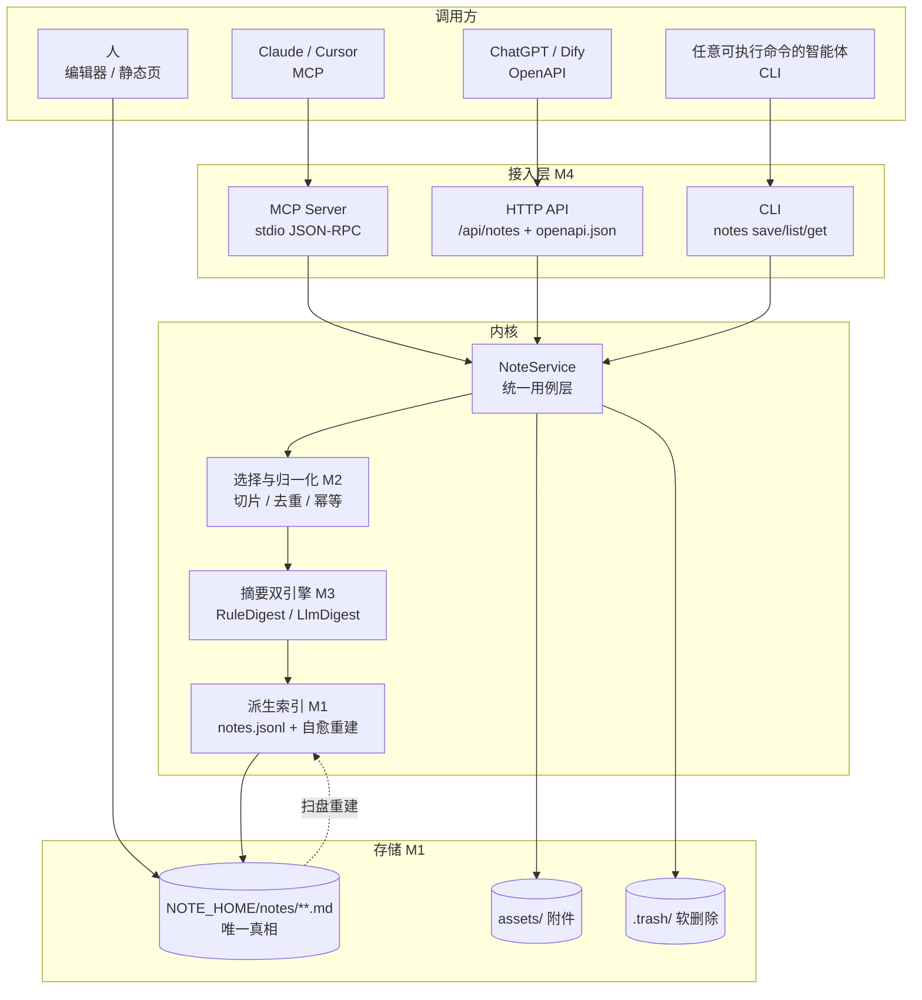
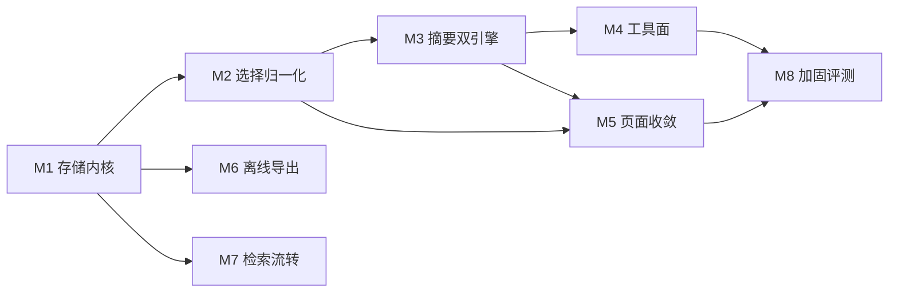

# 智能体笔记工具 · 改造规划（v2.0 方向）

> 状态：方案待确认（Phase 0–1 交付），尚未改动代码。
> 结论先行：把现有「五页 RAG 演示站」收成「两页 + 一个智能体可调用的个人笔记存储」。
> 存储以 Markdown 文件为唯一真相，索引可删可重建；摘要走「规则引擎保底 + 大模型增强」双引擎；
> 接入走「MCP 主通道 + HTTP 兼容 + CLI 兜底 + 文件直读」四级阶梯。

---

## 1. 目标与边界（五要素）

| 项 | 内容 |
|---|---|
| 目标 | 让任意智能体在对话中**挑选**有价值的内容，整理成结构化笔记，落到**用户自己的**目录；人能离线翻、随手改；同一份内容可被下一个智能体读到 |
| 输入 | 智能体传来的消息数组（含 role/text），可带选中范围、标题、标签、类型提示；也接受人工在页面上勾选 |
| 输出 | 一个 Markdown 文件（front matter + 六段正文）+ 一条索引记录 + 一个稳定 `note_id` |
| 成功指标 | ① 无大模型时 100% 能产出合法笔记；② 保存 P95 < 300ms（1k 字）；③ 索引删除后可 100% 重建；④ 人工改文件后读取立即生效（自愈率 100%）；⑤ ≥ 5 种智能体可按文档接入 |
| 约束 | 零第三方依赖（标准库）；全中文；单机优先、数据不出本机（除显式开启的大模型摘要）；不破坏现有问答与文档上传能力 |

**不做什么**：不做云端同步、不做多租户、不做向量化笔记库（先留接口）、不做自动抓取对话（必须显式调用/勾选）。

---

## 2. 先回答：这需要 Agent 吗？

**不需要，而且不该做成 Agent。**

这是给智能体用的**工具 + 记忆层**：无自主循环、无规划器、无工具编排。真正的 Agent 在调用方（Claude/Cursor/自研），本项目的职责是把「一次工具调用」做对：幂等、可预览、可撤销、格式稳定。

由此定下三条设计红线：

1. **不引入自主循环** —— 本项目没有 `while True`，不需要 max_steps；但必须给调用方提供**幂等键**与**预算上限**（单次摘要 token 上限），防止调用方重试把成本放大。
2. **写操作要能预览** —— `draft` 先返回渲染结果与目标路径，`commit` 才落盘；删除是 L2，必须带 `confirm_token`。
3. **格式即契约** —— 文件格式一旦发布就要向后兼容，所有接口都是它的皮。

---

## 3. 总体架构



关键取舍：

- **文件是真相，索引是缓存**。索引删了不丢数据；外部编辑以文件为准，索引只跟随不覆盖。
- **三个入口一套用例**。MCP/HTTP/CLI 只做协议转换，全部调 `NoteService`，避免三套行为漂移。
- **摘要是可插拔的**。`DIGEST=rule` 时零依赖零成本；`auto` 时有 Key 走模型、失败即降级。

---

## 4. 存储契约 v1（最贵的一步，先定死）

### 4.1 目录

```
NOTE_HOME（默认 ~/agent-notes，可用环境变量或 --home 覆盖）
├─ notes/2026/10/20261024-204512-7f3a9c.md     # 正文，路径即时间线
├─ assets/20261024-204512-7f3a9c/…             # 大代码块、附件（可选）
├─ index/notes.jsonl                            # 派生索引，可删
├─ index/tags.json                              # 派生
├─ exports/                                     # 单文件 HTML / bundle
├─ .trash/                                      # 软删除，默认留 30 天
└─ AGENTS.md                                    # 给智能体读的接入契约
```

文件名用 `id`，不用标题：避免改名、避免中文/特殊字符在跨平台同步时出问题；标题只放 front matter。

### 4.2 单个笔记

```markdown
---
schema: note/v1
id: 20261024-204512-7f3a9c
title: 出口退税申报口径确认
created: 2026-10-24T20:45:12+08:00
updated: 2026-10-24T20:45:12+08:00
kind: decision          # decision | howto | reference | qa | log
status: draft           # draft | final | archived
tags: [税务, 出口退税, 待跟进]
source:
  agent: claude-desktop
  model: claude-sonnet-4-5
  session: sess_8f21
  messages: 12
digest: rule            # rule | llm | llm-fallback
hash: sha256:9c1f…
---

## 摘要

一句话结论……

## 要点

- 要点一（≤ 40 字）
- 要点二

## 决策

- 采用 13% 退税率，2026-11-01 起执行

## 待办

- [ ] 财务部复核申报表（负责人待定）

## 原文

> 可选段落，`NOTE_KEEP_RAW=off` 时不写。

## 引用

- https://example.com/policy
```

六段固定顺序、缺则省略；正文允许用户任意增删小节（解析器按标题取段，多余小节原样保留）。

### 4.3 解析容错（决定"能不能随便改"）

| 情况 | 行为 |
|---|---|
| front matter 缺字段 | 用文件名/正文补默认值，`schema` 缺失仍可读 |
| front matter 语法坏掉 | 整篇按正文处理，`id` 取文件名，标记 `external: true`，**不报错** |
| 用户改了标题/标签 | 下次读取按 `mtime+size+hash` 判定变更，刷新索引 |
| 用户手动新增 .md | `notes index --rebuild` 扫盘纳入；服务读路径也会按需补录 |
| 同名 id 冲突 | 以 `created` 较早者为准，另一篇加 `-2` 后缀并写告警 |

---

## 5. 模块划分与优先级

| # | 模块 | 职责 | 关键产物 | 失败处理 | 优先级 | 规模 |
|---|---|---|---|---|---|---|
| M1 | 存储内核 | 契约、路径、原子写、锁、索引、自愈 | `src/notes/store.py`、`index.py` | 写失败回滚临时文件；索引坏 → 重建 | **P0** | M |
| M2 | 选择与归一化 | 消息切片、角色归一、去重、幂等、draft/commit | `src/notes/select.py` | 空选择 → 400 明确原因；超长 → 截断并标注 | **P0** | S |
| M3 | 摘要双引擎 | RuleDigest 保底、LlmDigest 增强、schema 校验、降级 | `src/notes/digest_rule.py`、`digest_llm.py` | 模型超时/坏 JSON → 回落规则并标 `digest: llm-fallback` | **P0** | M |
| M4 | 工具面 | MCP(stdio) / HTTP / CLI 三入口 + `AGENTS.md` | `src/notes/mcp_server.py`、`api.py`、`cli.py` | 协议层异常 → 结构化错误码，不抛栈 | **P0** | L |
| M5 | 页面收敛 | 删首页/数据中心；`/ask` 勾选保存；`/kb` 加「我的笔记」 | 改动 `web_pages.py`、`server.py` | 页面接口不可用 → 只读降级，仍可看笔记 | P1 | M |
| M6 | 离线导出 | 单文件 HTML、JSON bundle 导入导出 | `src/notes/export.py` | 导出失败保留已有文件，不半写 | P1 | S |
| M7 | 检索与流转 | 全文检索、标签、跨智能体接续、引用回链 | `src/notes/search.py` | 无索引走线性扫，结果标 `degraded` | P1 | M |
| M8 | 加固与评测 | 并发锁、权限、trace、20+ 评测集、备份 | `tests/eval_notes.py`、`docs/` | 任一项不过线 → 阻断发版 | P2 | M |

### 依赖与执行顺序



里程碑：

- **M0（0.5 天）** 收口页面：删 `/`（302→`/ask`）、删 `/insights` 与 `insights.py`，导航两项。先把"两页"这个前提坐实。
- **M1（P0 第一步）** 契约 + 存储内核 + 规则摘要 + CLI 竖切片 → 通过第 6 节 5 条验收。
- **M2（P0）** HTTP API（`/api/notes` 六个端点）+ `openapi.json` + `tools.json`。
- **M3（P0）** MCP stdio server（7 工具 + 2 resources）+ `AGENTS.md`。
- **M4（P1）** LLM 摘要接入（含预算、超时、降级）；`/ask` 勾选保存；`/kb` 笔记区。
- **M5（P1）** 离线导出 + 导入；全文检索。
- **M6（P2）** 评测集、压测、备份恢复、灰度。

---

## 6. 第一步：只做一件事（P0 竖切片）

> **把「一段对话 → 一个合法 Markdown 文件 → 读回来 → 手改后仍读得对」跑通，全程不接大模型。**

范围（只含 M1 + M2 最小集 + M3 的 `RuleDigest` + 一个 `notes` CLI）：

```
src/notes/__init__.py
src/notes/model.py       # Note 数据类、校验、序列化/反序列化
src/notes/store.py       # 路径、原子写、锁、软删除、扫盘
src/notes/index.py       # notes.jsonl 生成 / 重建 / 增量刷新
src/notes/select.py      # 消息切片、去重 hash、幂等表
src/notes/digest_rule.py # 规则摘要（标题/要点/决策/待办/引用）
src/notes/cli.py         # save / list / get / rebuild / export
tests/test_notes_store.py
tests/test_notes_digest_rule.py
```

CLI 接口（先定形，后续 HTTP/MCP 复用同一参数语义）：

```bash
notes save --from conv.json --kind decision --tags 税务,出口退税 [--draft] [--keep-raw]
notes list --tag 税务 --since 2026-10-01 --limit 20 --json
notes get <id> [--json]
notes rebuild
```

### 验收标准（可执行，缺一不算完成）

1. `notes save --from conv.json` 生成 `notes/2026/10/<id>.md`，front matter 六字段齐全，正文含「摘要 + 要点」两节。
2. 手工把标题改成「改过的标题」→ `notes get <id> --json` 返回新标题（自愈）。
3. `rm -rf index/` → 下次 `notes list` 自动重建，条数与磁盘 `.md` 数一致。
4. 同样的 `conv.json` 保存两次 → 第二次返回 `duplicate_of=<id>`，不产生新文件。
5. 把 front matter 删掉再读 → 不报错，`external: true`，标题取文件名/首行。
6. 1k 字笔记：`save` P95 < 300ms、`list`(1000 篇) < 100ms、零第三方依赖。

**为什么先做这个**：文件格式是唯一会被用户长期持有、被多个智能体共同读写的东西，改一次就要迁移全部数据；接口层（HTTP/MCP）都是薄壳，晚做一天不影响正确性，格式做错一天要还债一年。

---

## 7. 工具面设计（M4 预定稿）

| 工具 | 级别 | 输入要点 | 行为 |
|---|---|---|---|
| `save_conversation` | L1 可撤销写 | `messages[]`、`select`、`hint`、`mode=draft/commit`、`idempotency_key` | 草稿只渲染不落盘；commit 写文件并返回 `id/path/preview` |
| `preview_note` | L0 只读 | 同 `save_conversation`，强制 draft | 返回 markdown 预览与目标路径 |
| `search_notes` | L0 | `query`、`tags[]`、`since/until`、`limit≤50` | 返回 `id/title/summary/tags/updated` |
| `get_note` | L0 | `id`、`section?` | 返回正文，超 6000 字截断并标 `truncated` |
| `append_to_note` | L1 | `id`、`markdown`、`section` | 追加到指定小节，不重写其他内容 |
| `update_note` | L1 | `id`、`base_hash`、`patch` | 乐观锁，hash 不符返回 `409 conflict` |
| `delete_note` | L2 | `id`、`confirm_token` | 移入 `.trash`，可 restore |

resources：`note://{id}`（单篇全文）、`notes://recent`（最近 20 条摘要）——让智能体不调工具也能读。

错误码统一：`invalid_argument` / `not_found` / `conflict` / `duplicate` / `unavailable` / `confirm_required`，全部带 `message` 与可执行建议；不向上抛异常栈。

---

## 8. 摘要双引擎与降级矩阵

| 场景 | 引擎 | 输出 | 标记 |
|---|---|---|---|
| 无 Key / `DIGEST=rule` | RuleDigest（分句打分 + 关键词段落归类） | 六段中至少摘要 + 要点 | `digest: rule` |
| 有 Key / `DIGEST=auto` 或 `llm` | LlmDigest（JSON 输出 + 强校验） | 六段齐全 | `digest: llm` |
| 模型超时 / 非 200 / JSON 坏 / 字段非法 | 先重试 2 次（指数退避 + 抖动），仍失败 → RuleDigest | 与规则同 | `digest: llm-fallback` + `degrade_reason` |
| 输入超长 | 先按 token 预算截断（保留首尾） | 标 `truncated` | `digest: *` |

硬性要求：**RuleDigest 永不抛异常**，任何输入都要产出可用笔记——这是"不依赖大模型也能完成基本功能"的兜底。

---

## 9. 多智能体适配矩阵

| 智能体 | 接入方式 | 说明 |
|---|---|---|
| Claude Desktop / Claude Code | MCP stdio | 配置里填启动命令与 `NOTE_HOME` |
| Cursor / Windsurf / Cline | MCP stdio | 同上，一套配置通用 |
| ChatGPT（Actions）/ Dify / Coze | OpenAPI HTTP | 读 `/openapi.json`，需可达地址（本机需隧道） |
| LangChain / LlamaIndex / 自研 | HTTP 或 `tools.json` | 直接拿 function schema |
| 只给执行命令的智能体 | CLI `--json` | 兜底通道，任何环境可用 |
| 完全离线 | 直接读 Markdown | 无服务、无依赖、无 Key |

四层阶梯的意义：**文件是通用货币，MCP 是主通道，HTTP 是广谱适配，CLI 是兜底**。任何一个通道坏掉，其余仍可用。

---

## 10. 页面收敛

| 现状 | 处置 |
|---|---|
| `/` 首页 | 删除，302 → `/ask` |
| `/insights` 数据中心 + `insights.py` + `report.py` 在线渲染 | 删除（`report.py` 的 CLI 导出如仍需要，保留为纯脚本） |
| `/ask` 问答 | 保留；新增「勾选轮次 → 预览 → 保存」，保存后展示 `note_id` 与文件路径 |
| `/kb` 文档上传 | 保留上传；新增「我的笔记」分区（列表 / 搜索 / 预览 / 编辑跳转 / 删除 / 导出） |
| 导航 | 两项：问答、知识库 |

> 假设：个人笔记的浏览入口放在 `/kb`（原上传页）内，而不是新增第三页——这样才符合"仅保留两页"。

---

## 11. 风险清单

| 风险 | 概率 | 影响 | 应对 |
|---|---|---|---|
| 文件格式定错，后期迁移痛苦 | 中 | 高 | 第 6 节 6 条验收先跑通再谈接口；`schema: note/v1` 显式版本号 |
| 手写 MCP/JSON-RPC 与各家客户端不兼容 | 中 | 中 | 先只做 stdio（最稳），HTTP 传输后置；保留官方 SDK 可选适配层 `[待核实: 查阅 MCP 规范当前版本与传输定义]` |
| 用户手改文件把 front matter 改坏 | 高 | 低 | 容错解析，坏格式降级为 `external`，永不 500 |
| 笔记与文档库混检污染问答 | 中 | 中 | 默认物理隔离：笔记不进 RAG 检索；需要时用开关打开 |
| 对话原文含敏感信息 | 中 | 高 | 原文段默认关闭（`NOTE_KEEP_RAW=off`）、日志脱敏、除摘要外不出网 |
| 并发写同一篇（人改 + 智能体追加） | 中 | 中 | 目录锁 + `base_hash` 乐观锁；追加型写入优先，少整篇重写 |

---

## 12. 决策记录（2026-10-24 已定，不再待确认）

| # | 议题 | 决定 | 理由 |
|---|---|---|---|
| 1 | 存储位置 | 默认 `~/agent-notes`，`NOTE_HOME` 或 `--home` 覆盖 | 「个人储存空间」要跨项目、跨智能体复用；放项目里换个目录就丢 |
| 2 | 首页与数据中心 | 删除；`/`、`/insights`、`/dashboard`、`/report` 全部 302 到 `/ask` | 只留两页；旧链接不 404 |
| 3 | 笔记浏览入口 | 并入 `/kb` 的第二分区，不新增第三页 | 用户明确「仅保留问答页和文档上传页」 |
| 4 | 原文默认 | 不保存；`--keep-raw` 或 `NOTE_KEEP_RAW=on` 才写 | 对话原文最容易带敏感信息，默认少存 |
| 5 | 接入顺序 | 先 HTTP（便于自测与 CI），再做 MCP；MCP 只做 stdio | stdio 跨客户端最稳，HTTP 传输等规范稳定后再补 |

## 13. 第一步完成情况（v1.10.0）

已落地并验证（`tests/test_notes_store.py`、`tests/test_notes_digest_rule.py`）：

- Note v1 契约、原子写、目录锁、派生索引、扫盘重建、软删除。
- 规则摘要（无模型）覆盖正常/边界/对抗共 20 条样本，另有 8 类非法输入的可读报错。
- CLI 五个子命令，`--json` 供机器消费。
- 页面收口为两页，旧入口 302。

实测：保存 P95 19 ms、列出 1000 篇 21 ms、索引重建 2.0 s（并行读）。

### 第二步（v1.11.0，已完成）

- 六个 HTTP 端点：POST / GET / GET{id} / PATCH / DELETE / stats；`PATCH` 用 `rev` 乐观锁，`DELETE` 需 `confirm`。
- `GET /tools.json` 给出 5 个 function calling 工具声明；`/openapi.json` 增加到 21 个路径。
- 鉴权与问答同口径；`NOTES_CORS` 默认关闭，显式配置才放行浏览器跨域。
- `tests/test_notes_api.py` 覆盖 11 组场景（含 401、409、confirm_required）。

### 第三步（v1.12.0，已完成，M3/M4/M5/M6 收口）

| 里程碑 | 落地 | 测试 |
|---|---|---|
| M3 摘要双引擎 | `digest_llm.py`：JSON 校验 + 四类失败回落 + `digest_fallback` 留痕；`auto` / `llm` 两种严格度 | `test_notes_digest_llm.py` 25 项 |
| M4 工具面 | MCP stdio 7 工具 + 2 资源；`/tools.json` 与 MCP 共用 schema；`AGENTS.md` 两条（仓库 + 笔记库） | `test_notes_mcp.py` 31 项 |
| M5 页面收敛 | `/kb` 第二分区（列表 / 编辑 / 删除 / 导出）；`/ask` 每条回答「存为笔记」+ 预览 | `tests/e2e_notes.mjs` 23 项 |
| M6 离线导出 | 单文件 HTML（自包含、转义、原子写）+ JSON bundle；CLI / HTTP / MCP 三处入口 | `test_notes_export.py` 26 项 |

四条通道现在是：文件直读 → CLI → HTTP → MCP，任一层坏了其余仍可用。
未做（后续可选）：跨设备同步、附件上传、按语义检索笔记（当前是标签 + 关键词）。
