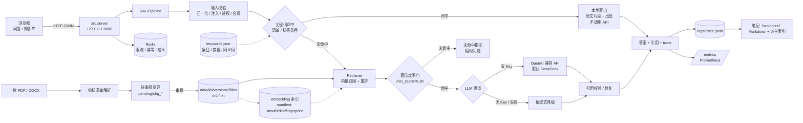
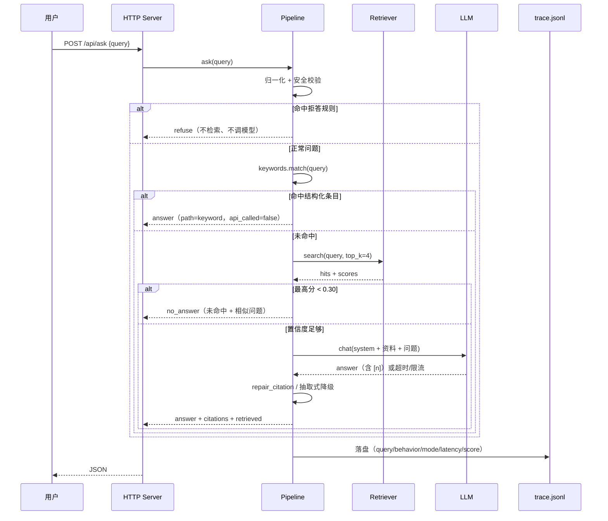

# 架构说明

## 1. 这是工作流，不是 Agent

本项目的控制流是固定的「检索 → 生成 → 引用校验」，分支可以穷举：

- 输入不合法 → 拒答 / 追问；
- 检索分低于阈值 → 返回未命中提示与相似问题；
- 模型超时或限流 → 重试，仍失败则降级为抽取式；
- 答案没有有效引用 → 修复引用，修不好则降级并标记。

按「能写出 if/else 穷举分支就不上 Agent」的判定，这里不需要自主循环，也不需要工具编排。
上 Agent 只会额外引入不确定性、成本和运维负担。

真正需要升级为 Agent 的条件：模型必须动态决定调用哪些外部系统（实时行情、IRR 计算、工单、线下预约），
且路径依赖中间结果、无法穷举。届时采用「固定链路 + 有界工具调用循环」，并强制
`max_steps / token 预算 / 墙钟上限 / 停止条件 / 人工接管点`。

## 2. 部署形态

## 3. 请求时序

## 4. 组件职责

| 组件 | 文件 | 职责 | 失败时 |
|---|---|---|---|
| 配置 | `src/config.py` | 通道、超时、重试、阈值、profile | 缺失 Key → 离线模式；非法通道 → 回退默认 |
| 切分 | `src/chunking.py` | 标题/条款感知切块；按文件 mtime 缓存，增量重建只重解析变更文档 | 目录不存在 → 启动失败并明确报错 |
| 关键词 | `src/keywords.py` | 清单/表格/标签抽条目，命中本地直出；可选 API 补摘要与同义词 | 构建失败只记录；不命中走检索，不影响主链路 |
| 检索 | `src/retriever.py` | embedding 召回 + 多信号重排；n-gram / BM25 兜底 | embedding 失败 → 当次回退词法检索并标 `degraded` |
| embedding | `src/embeddings.py` | OpenAI 兼容 `/embeddings`；批请求、超时、重试、维度探测、内容缓存 | 抛 `EmbeddingError`，由检索层降级 |
| 向量索引 | `src/vector_store.py` | 纯 Python / NumPy / FAISS；manifest 记录模型、维度、语料指纹 | 指纹不匹配自动重建；维度不一致报错 |
| 知识库版本 | `src/kbstore.py` | 版本目录、审批流、按文档回滚；未变更文件硬链接，保留最近 N 版 | 版本只增不改；激活原子替换；硬链接失败回退复制 |
| Redis 客户端 | `src/redis_client.py` | RESP2；GET/SET NX PX/INCRBY/EVAL；超时与重连 | 抛 `RedisError`，guard 回退本地 |
| 示例问题 | `src/suggest.py` | 按文档章节生成示例问题与相似问题 | 无候选 → 回退文档级问题 |
| 生产防护 | `src/guards.py` | 限流、幂等、成本上限、审计、灰度、回滚；本地 / Redis 双后端 | 本地状态落盘 `logs/`；Redis 失败回退并暴露 |
| 指标导出 | `src/metrics_exporter.py` | Prometheus 文本格式：请求、延迟、降级、token | 采集失败不影响业务 |
| 查询扩展 | `src/query.py` | 用语料词表扩展问题，提升召回 | 失败自动回退原问题（重试一次） |
| 生成 | `src/generator.py` | LLM 调用、抽取式兜底、引用修复 | 超时/429 → 退避重试；最终降级 |
| 编排 | `src/pipeline.py` | 校验、闸门、生成、引用、trace；索引后台重建与原子替换 | 任一步失败都有明确行为（见下表）；重建失败保留旧索引 |
| 鉴权 | `src/auth.py` | API Key 解析、常量时间校验、脱敏 | 缺失/错误 → 401 + `WWW-Authenticate` |
| 契约 | `src/openapi.py` | OpenAPI 3.0 描述（问答、知识库、运维） | 静态生成，无运行时依赖 |
| 指标 | `src/metrics.py` | 从 trace 聚合 P50/P95、行为分布、降级率 | 无 trace → 返回空指标 |
| 文档解析 | `src/pdf_text.py` / `src/docx_text.py` | 纯标准库解析 PDF / DOCX | 扫描件 / 加密 / 假后缀 → 4xx 明确报错 |
| 评测 | `src/evaluator.py` | L1 断言内核，CLI 与服务端共用 | 用例引用文档已删 → skip，不算失败 |
| Web | `src/server.py` | 两页 + JSON API + 上传 | 4xx/5xx JSON，不返回 HTML 错误页 |
| 页面 | `src/theme.py` / `src/web_pages.py` | 设计系统、问答页、知识库页 | 无 API 时页面仍可打开 |
| 笔记 | `src/notes/` | Note v1 存储、规则摘要、CLI 与 HTTP（`/api/notes`，文件为真相） | 索引坏/缺 → 扫盘重建；front matter 坏 → `external` 降级；改冲突 → 409 |

## 5. 失败处理矩阵

| 环节 | 触发条件 | 动作 | 用户看到什么 |
|---|---|---|---|
| 输入 | 空 / 超长（>500 字） | `ask_clarify` | 提示补充或缩短问题 |
| 输入 | 提示注入 / 越权 / 荐股 | `refuse` | 明确拒绝，不进检索 |
| 关键词 | 命中条目 | `answer` + `path=keyword` | 原文片段直出，不调用模型；`api_called=false` |
| 关键词 | 未命中 / 索引构建失败 | 继续走检索 | 失败原因写 `/api/health.keywords.error` |
| 检索 | 最高分 < 0.30（embedding 默认 0.38） | `no_answer` | 提示未找到，并展示相似问题 / 工单入口 |
| 检索 | 检索器异常 | 空结果 + `degraded=true` | 返回「无法找到答案」，不硬答 |
| embedding | 超时 / 429 / 维度不一致 | 当次回退 BM25 重排，标 `embedding_error` | 有答案但标注降级 |
| 索引 | manifest 指纹不匹配 | 启动/首次查询时重建 | 首次查询延迟增加 |
| 索引 | 后台重建失败 | 保留旧索引，写 `index.last_error`，不自动重试 | 知识库页提示；问答不受影响 |
| 索引 | 重建进行中 | 旧索引继续服务，新索引就绪后原子替换 | 新文档有短暂「已入库但搜不到」窗口 |
| 鉴权 | 缺少 / 错误 API Key | 401 + `WWW-Authenticate` | 明确提示携带方式（仅配置 `API_KEYS` 后） |
| Redis | 连接失败 / 超时 | 回退进程内限流/幂等/成本，30s 后重试 | 服务可用；多实例状态短暂不一致 |
| 审批 | 基线版本已过期 | 拒绝审批，提示重新提交 | `409` + 明确原因 |
| LLM | 超时（30s）/ 429 | 指数退避重试 3 次，尊重 `Retry-After` | 延迟增加，最终可能降级 |
| LLM | 未配置 Key | 抽取式回答 | 标注「离线抽取模式」 |
| LLM | 重试耗尽 | 抽取式降级 | `mode=extractive_fallback` |
| 引用 | 答案无有效 `[n]` | 先修复引用，失败则抽取式 | `degraded` / `no_citation` |
| 上传 | 假后缀 / 路径穿越 | 400 | 明确错误原因 |
| 上传 | 扫描件 / 加密 PDF | 422 | 提示先 OCR / 解密 |
| 上传 | 超过大小限制 | 413 | 提示上限（文本 512KB / PDF 与 DOCX 6MB） |
| 接入 | 超过限流 | 429 + `Retry-After` | 客户端按建议时间重试 |
| 成本 | 当日 token 超预算 | 跳过模型、抽取式回答 | `degraded=true` / `budget_exceeded` |

## 6. 扩展点

1. **换领域**：`APP_PROFILE=generic` 去掉金融合规护栏；或新增 profile（提示词 + 拒答规则）。
2. **换语料**：把文档放进 `data/knowledge/`，或在知识库页拖拽上传；上传后自动重建索引。
3. **换检索**：`RETRIEVAL=embedding|vector|bm25|hybrid`；`build_retriever` 是唯一工厂。embedding 端点换模型只改环境变量，索引按 manifest 自动重建。
4. **换通道**：任何 OpenAI 兼容网关，改 `base_url` / `model` / Key 环境变量即可。
5. **多实例**：`REDIS_URL` 共享限流/幂等/成本；`/metrics` 交给 Prometheus；审计 `LOG_SINK=stdout` 交给 Fluent Bit。
6. **灰度与回滚**：`POST /api/admin/config` 调整 `canary_percent` / `canary_model`，`POST /api/admin/rollback` 恢复上一版；知识库用 `POST /api/kb/rollback_doc` 按文档回退。
7. **升级为 Agent**：在 `pipeline.py` 的生成层外挂有界工具调用循环，保留现有闸门与引用校验作为最终出口。

## 7. 不在范围内

- 多租户与统一 SSO：当前只有可选的 `API_KEYS`（调用方级）与 `ADMIN_TOKEN`（管理接口），
  租户隔离、配额分级、OIDC 登录不在范围内。
- 扫描件 OCR：仅处理文本型 PDF。
- 投资建议与收益承诺：触发即拒答。
