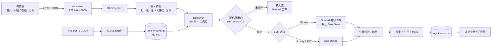
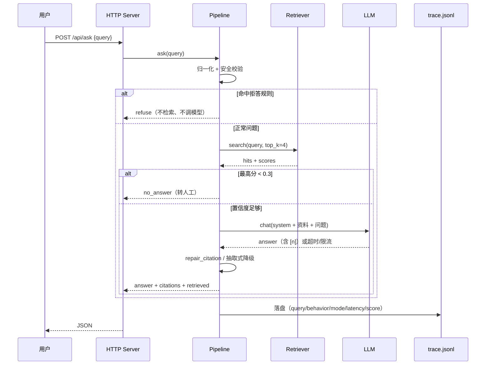

# 架构说明

## 1. 这是工作流，不是 Agent

本项目的控制流是固定的「检索 → 生成 → 引用校验」，分支可以穷举：

- 输入不合法 → 拒答 / 追问；
- 检索分低于阈值 → 转人工；
- 模型超时或限流 → 重试，仍失败则降级为抽取式；
- 答案没有有效引用 → 修复引用，修不好则降级并标记。

按「能写出 if/else 穷举分支就不上 Agent」的判定，这里不需要自主循环，也不需要工具编排。
上 Agent 只会额外引入不确定性、成本和运维负担。

真正需要升级为 Agent 的条件：模型必须动态决定调用哪些外部系统（实时行情、IRR 计算、工单、线下预约），
且路径依赖中间结果、无法穷举。届时采用「固定链路 + 有界工具调用循环」，并强制
`max_steps / token 预算 / 墙钟上限 / 停止条件 / 人工接管点`。

## 2. 部署形态

## 3. 请求时序

## 4. 组件职责

| 组件 | 文件 | 职责 | 失败时 |
|---|---|---|---|
| 配置 | `src/config.py` | 通道、超时、重试、阈值、profile | 缺失 Key → 离线模式；非法通道 → 回退默认 |
| 切分 | `src/chunking.py` | 标题/条款感知切块，中文二元组检索单元 | 目录不存在 → 启动失败并明确报错 |
| 检索 | `src/retriever.py` | BM25（默认）/ hybrid（可选） | 异常 → 不检索并标 `degraded` |
| 查询扩展 | `src/query.py` | 用语料词表扩展问题，提升召回 | 失败自动回退原问题（重试一次） |
| 生成 | `src/generator.py` | LLM 调用、抽取式兜底、引用修复 | 超时/429 → 退避重试；最终降级 |
| 编排 | `src/pipeline.py` | 校验、闸门、生成、引用、trace | 任一步失败都有明确行为（见下表） |
| 指标 | `src/metrics.py` | 从 trace 聚合 P50/P95、行为分布、降级率 | 无 trace → 返回空指标 |
| 文档解析 | `src/pdf_text.py` / `src/docx_text.py` | 纯标准库解析 PDF / DOCX | 扫描件 / 加密 / 假后缀 → 4xx 明确报错 |
| 评测 | `src/evaluator.py` | L1 断言内核，CLI 与服务端共用 | 用例引用文档已删 → skip，不算失败 |
| Web | `src/server.py` | 四页 + JSON API + 上传 | 4xx/5xx JSON，不返回 HTML 错误页 |
| 页面 | `src/theme.py` / `src/web_pages.py` / `src/report.py` | 设计系统、四页、独立汇报导出 | 无 API 时首页指标显示 `—`，页面仍可打开 |

## 5. 失败处理矩阵

| 环节 | 触发条件 | 动作 | 用户看到什么 |
|---|---|---|---|
| 输入 | 空 / 超长（>500 字） | `ask_clarify` | 提示补充或缩短问题 |
| 输入 | 提示注入 / 越权 / 荐股 | `refuse` | 明确拒绝，不进检索 |
| 检索 | 最高分 < 0.3 | `no_answer` | 说明资料不足，可提交工单 |
| 检索 | 检索器异常 | 空结果 + `degraded=true` | 转人工，不硬答 |
| LLM | 超时（30s）/ 429 | 指数退避重试 3 次，尊重 `Retry-After` | 延迟增加，最终可能降级 |
| LLM | 未配置 Key | 抽取式回答 | 标注「离线抽取模式」 |
| LLM | 重试耗尽 | 抽取式降级 | `mode=extractive_fallback` |
| 引用 | 答案无有效 `[n]` | 先修复引用，失败则抽取式 | `degraded` / `no_citation` |
| 上传 | 假后缀 / 路径穿越 | 400 | 明确错误原因 |
| 上传 | 扫描件 / 加密 PDF | 422 | 提示先 OCR / 解密 |
| 上传 | 超过大小限制 | 413 | 提示上限（文本 512KB / PDF 与 DOCX 6MB） |

## 6. 扩展点

1. **换领域**：`APP_PROFILE=generic` 去掉金融合规护栏；或新增 profile（提示词 + 拒答规则）。
2. **换语料**：把文档放进 `data/knowledge/`，或在看板拖拽上传；上传后自动重建索引。
3. **换检索**：`RETRIEVAL=hybrid` 启用哈希向量 + RRF + 重排；接口已隔离，可替换为真实 embedding。
4. **换通道**：任何 OpenAI 兼容网关，改 `base_url` / `model` / Key 环境变量即可。
5. **升级为 Agent**：在 `pipeline.py` 的生成层外挂有界工具调用循环，保留现有闸门与引用校验作为最终出口。

## 7. 非目标

- 不做多租户、鉴权、限流、审计与灰度——这是本地演示项目，不是生产系统。
- 不做扫描件 OCR。
- 不提供投资建议，不做收益承诺。
